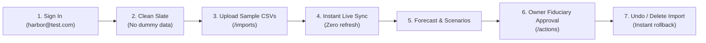

# HarborCFO — Autonomous Deterministic SME Finance Copilot

[](https://github.com/azmaeenmahtab/Shenzen-Fintechathon)
[](https://harborcfo.vercel.app/)
[](https://www.typescriptlang.org/)

**HarborCFO** is an autonomous, deterministic, and fiduciary-grade SME finance copilot developed for the **2026 Shenzhen International FinTech Competition (International Track, Topic E)**. It combines 91-day deterministic cash flow forecasting, multi-factor financing remedy matching, role-based access control (RBAC), and an AI copilot with real-time tool execution telemetry.

---

## 1. Essential Links & Competition Deliverables

| Resource | Link / Path | Description |
| :--- | :--- | :--- |
| **Live Application** | [https://harborcfo.vercel.app/](https://harborcfo.vercel.app/) | Production deployment with SSL and live API |
| **GitHub Repository** | [azmaeenmahtab/Shenzen-Fintechathon](https://github.com/azmaeenmahtab/Shenzen-Fintechathon) | Complete monorepo source code |


---

## 2. Judge & Evaluator Credentials

> [!IMPORTANT]
> **No Pre-Loaded Demo Data**: When judges log into either account below, the workspace opens in a **clean-slate state with zero dummy or pre-loaded records**. Judges first import the sample CSV files provided in Section 3 to evaluate the live platform. All pages update **instantly upon import**.

### Demo Accounts
| Role | Name | Email | Password | Authority |
| :--- | :--- | :--- | :--- | :--- |
| **Owner** | Harbor Owner | `harbor@test.com` | `harbor_test` | Full authority (signs single-use debt tokens, executes draws, deletes imports) |
| **Employee** | Harbor Employee | `harbor@employee.com` | `harbor_employee` | Operator (imports data, simulates scenarios, uses copilot; restricted from debt execution) |

---

## 3. Sample CSV Datasets for Ingestion Testing

Download or copy these two verified sample CSV files from the repository root to test the live ingestion engine:

### Dataset A: Bank Transactions ([`sample-transactions-test.csv`](sample-transactions-test.csv))
Upload under **Data Ingestion** (`/imports`) with Type set to **Bank Transactions**:
```csv
externalId,date,accountId,amount,currency,category,description
TX-TEST-001,2026-10-15,OPERATING,45000.00,CNY,customer_receipt,Payment from Customer A for services
TX-TEST-002,2026-10-18,OPERATING,-18000.00,CNY,supplier_payment,Hardware component supplier payment
TX-TEST-003,2026-10-20,OPERATING,-12500.00,CNY,rent,Shenzhen office October rent
TX-TEST-004,2026-10-25,OPERATING,-38000.00,CNY,payroll,Engineering team payroll
TX-TEST-005,2026-10-28,OPERATING,22000.00,CNY,customer_receipt,Client milestone settlement
```

### Dataset B: Invoices Receivable & Payable ([`sample-invoices-test.csv`](sample-invoices-test.csv))
Upload under **Data Ingestion** (`/imports`) with Type set to **Invoices (AR/AP)**:
```csv
invoiceId,direction,counterpartyId,total,outstanding,currency,dueDate,expectedSettlementDate,status
INV-TEST-AR-101,AR,CUSTOMER-A,35000.00,35000.00,CNY,2026-11-05,2026-11-06,open
INV-TEST-AR-102,AR,CUSTOMER-B,48000.00,48000.00,CNY,2026-11-12,2026-11-15,open
INV-TEST-AP-201,AP,VENDOR-X,22000.00,22000.00,CNY,2026-11-08,2026-11-08,open
INV-TEST-AP-202,AP,LOGISTICS-HUB,16500.00,16500.00,CNY,2026-11-20,2026-11-20,open
INV-TEST-AR-103,AR,CUSTOMER-C,12000.00,0.00,CNY,2026-10-15,2026-10-14,paid
```


---

## 4. Step-by-Step Evaluation Test Cases



### Test Case 1: Sign In & Clean Slate Verification
1. Open [https://harborcfo.vercel.app/sign-in](https://harborcfo.vercel.app/sign-in).
2. Sign in as **Harbor Owner** (`harbor@test.com` / `harbor_test`).
3. View **Dashboard**, **Forecast**, **Alerts**, **Financing**, and **Scenarios**:
   - **Verification**: Clean "Awaiting Financial Data" onboarding UI appears across all pages. No fake numbers or flat zero-charts.
   - *(Optional)*: Click **"Explore with Demo Data"** to test the temporary preview sandbox, then click **"Exit Preview"** in the top banner.

### Test Case 2: Ingest Sample CSVs & Zero-Refresh Live Update
Judges can ingest financial data using either the standard upload wizard or our Smart AI Import feature:
- **Option A (Standard CSV Dropzone)**:
  1. Navigate to **Data Ingestion** (`/imports`).
  2. Upload [`sample-transactions-test.csv`](sample-transactions-test.csv) (Type: Bank Transactions) $\rightarrow$ Click **Upload & Validate** $\rightarrow$ Click **Commit Import to Ledger**.
  3. Upload [`sample-invoices-test.csv`](sample-invoices-test.csv) (Type: Invoices) $\rightarrow$ Click **Upload & Validate** $\rightarrow$ Click **Commit Import to Ledger**.
- **Option B (Smart AI Data Mapper)**:
  1. On `/imports`, switch to the **"Smart AI Data Mapper"** tab.
  2. Upload or paste any raw or messy business spreadsheet/text (or the sample files above).
  3. Click **"Transform with Smart AI"**: the LLM automatically maps columns, detects currencies, and converts records into canonical schema with 1-click preview and commit.
- **Verification**: Switch to **Dashboard** or **Forecast** in the sidebar (do **not** refresh the browser). The onboarding cards disappear immediately, and all cash positions, trajectories, and aging charts render live data in real time via SSE cache invalidation.

### Test Case 3: 91-Day Forecast & Transaction Provenance Drilldown
1. Navigate to **Cash Forecast** (`/forecast`).
2. Inspect the day-by-day cash runway curve computed deterministically from the uploaded records.
3. Click on any date point on the chart.
   - **Verification**: A slide-out provenance drawer shows the exact underlying invoice and transaction IDs.

### Test Case 4: Remedy Matching & What-If Sandbox Simulation
1. Navigate to **Financing** (`/financing`):
   - Review ranked facilities scored by total borrowing cost ($0.40 \cdot \text{timing} + 0.35 \cdot \text{cost} + 0.25 \cdot \text{resilience}$).
2. Click **"Simulate in Sandbox"** to jump into **Scenarios** (`/scenarios`).
3. Click **"Run Simulation"**:
   - **Verification**: Dual comparison curve (blue baseline vs orange simulation) displays the restored liquidity trajectory.
4. Click **"Propose Formal Action"** to stage an executable debt proposal (`/actions`).

### Test Case 5: Fiduciary Role-Based Access Control (RBAC) Enforcement
1. Sign out and sign in as **Harbor Employee** (`harbor@employee.com` / `harbor_employee`).
2. Navigate to **Action Approvals** (`/actions`):
   - **Verification**: "Approve & Execute" button is disabled/hidden with *"Requires Owner Authority"* badge.
3. Sign back in as **Harbor Owner** (`harbor@test.com` / `harbor_test`) on `/actions`:
   - Click **"Approve Proposal"** $\rightarrow$ Signs a single-use SHA-256 approval token.
   - Click **"Execute Atomic Draw"** $\rightarrow$ Disburses funds into the operating ledger.

### Test Case 6: Owner Import History Management & Reversible Deletion
1. While signed in as **Harbor Owner**, navigate to `/imports` and scroll to **Import History**.
2. Click the **Delete** (trash) icon on any committed import batch and confirm.
   - **Verification**: The batch is deleted, ledger transactions and invoices roll back atomically, and all forecast curves and dashboard summaries update immediately. (Employee account strictly receives `403 Forbidden`).

### Test Case 7: Autonomous Copilot with Real-Time Tool Telemetry
1. Navigate to **Copilot** (`/agent`).
2. Ask: *"What is causing the cash gap?"* or *"Analyze my upcoming invoices"*.
3. **Verification**: Live telemetry timeline streams tool execution steps (`read_forecast`, `detect_breach`) with zero LLM hallucination and clickable evidence chips.

---

## 5. Deployment Instructions

### Local Development Setup

#### Prerequisites
- **Node.js**: `>= 20.0.0 LTS`
- **pnpm**: `>= 9.0.0`
- **MongoDB**: Replica Set v6+ (local via Docker or MongoDB Atlas)

#### Quick Start Commands
```bash
# 1. Clone repository
git clone https://github.com/azmaeenmahtab/Shenzen-Fintechathon.git
cd Shenzen-Fintechathon

# 2. Install dependencies
pnpm install

# 3. Configure environment
cp .env.example .env
cp apps/web/.env.example apps/web/.env.local

# 4. Seed demo accounts (Harbor Owner & Employee)
pnpm seed:demo

# 5. Start development servers (Web on :3000, API on :3001)
pnpm dev
```

### Cloud Deployment (Vercel)
The web app is configured for Vercel deployment:
- **Root Directory**: `apps/web`
- **Build Command**: `cd ../.. && pnpm --filter @harbor/web build`
- **Environment Variable**: `NEXT_PUBLIC_API_URL` pointing to the API microservice.

---

## 6. Automated Test Suite

```bash
# Type check all packages
pnpm typecheck

# Run unit and integration tests (Vitest)
pnpm test

# Run Playwright End-to-End tests (Headless Chromium)
pnpm test:e2e

# Export cryptographic verification package
pnpm evidence:export
```
