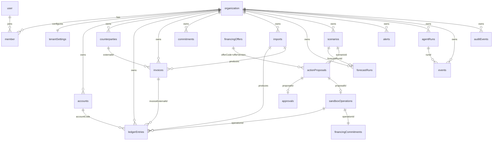

# Database schema (MongoDB, one database shared by web and api)

Single source of truth for every collection. Update this file in the same commit as any model change.
Conventions: `_id` is an ObjectId (API exposes it as string `id`). `tenantId` is the string form of the Better Auth organization id. `Minor` = integer fen. `DateOnly` = `YYYY-MM-DD` string. Every domain document has `createdAt` and `updatedAt` (Date) unless noted.

## 1. Entity relationships

Relations by key (no MongoDB joins in the domain; services resolve them):
- `member.organizationId` = `tenantId` of every domain document. `member.userId` = actor `userId`.
- Counterparty link: `invoices.counterpartyExternalId` and `ledgerEntries.counterpartyExternalId` -> `counterparties.externalId` (same tenant).
- Account link: `ledgerEntries.accountCode` -> `accounts.code`.
- Invoice settlement link: `ledgerEntries.invoiceExternalId` -> `invoices.externalId`.
- Financing: `actionProposals.offerCode` + `offerVersion` -> `financingOffers`. Execution creates one `sandboxOperations` doc, one `financingCommitments` doc, and two `ledgerEntries` (draw and fee).

## 2. Better Auth collections (owned by Better Auth, do not write from the API)

The web app's Better Auth instance creates and manages these. The API only reads `member` and `organization` (and `user` for display), never writes. Exact stored field types (ObjectId vs string for ids) must be verified in chunk S02 and recorded here.

| Collection | Key fields (per Better Auth docs) | Used by API |
| --- | --- | --- |
| user | id, name, email, emailVerified, image, createdAt, updatedAt | read (display names) |
| session | id, userId, token, expiresAt, ipAddress, userAgent, activeOrganizationId | no |
| account | id, userId, providerId, accountId, password (hash), timestamps | no |
| verification | id, identifier, value, expiresAt | no |
| organization | id, name, slug, logo, metadata, createdAt | read (tenant exists) |
| member | id, organizationId, userId, role, createdAt | read (role per request) |
| invitation | id, organizationId, email, role, status, expiresAt, inviterId | no |
| jwks | id, publicKey, privateKey (encrypted), createdAt | no (API reads the public JWKS over HTTP) |

Roles stored in `member.role`: `owner`, `employee`, `reviewer`.

## 3. Domain collections

Types: `S` string, `N` number, `I` integer, `B` boolean, `D` Date, `DO` DateOnly string, `[]` array.

### tenantSettings (one per tenant)
| Field | Type | Notes |
| --- | --- | --- |
| tenantId | S | unique |
| reportingCurrency | S | `CNY` only |
| minimumCashMinor | I | liquidity floor |
| businessTimezone | S | IANA, default `Asia/Shanghai` |
| datasetVersion | I | starts at 1; +1 on every committed change to ledger/invoices/commitments/financing |
| forecastAsOfDate | DO? | demo override so anchor numbers stay stable |
| overdueAlertDays | I | default 7 |
| concentrationThresholdPct | I | default 40 |
| staleDataDays | I | default 14 |
| profile | object | `yearsInOperation` I?, `employeeCount` I?, `industry` S?, `monthlyRevenueMinor` I?, `monthlyCardSalesMinor` I? |
| isDemo | B | |

Index: unique `(tenantId)`.

### accounts
`tenantId`, `code` (S, e.g. `OPERATING`), `name`, `currency`, `openingBalanceMinor` I, `openingBalanceDate` DO.
Cash at a date = `openingBalanceMinor` + sum(`ledgerEntries.amountMinor`) for entries booked after `openingBalanceDate` up to that date. Entries on or before the opening date are history for analytics only.
Index: unique `(tenantId, code)`.

### counterparties
`tenantId`, `externalId` (S, e.g. `CUSTOMER-A`), `type` (`customer`|`vendor`), `name`, `maskedName` (S, e.g. `Customer A`, the only form sent to the LLM).
Index: unique `(tenantId, externalId)`.

### ledgerEntries
| Field | Type | Notes |
| --- | --- | --- |
| tenantId | S | |
| accountCode | S | |
| externalId | S | stable id from the CSV or generated for sandbox entries |
| bookedOn | DO | |
| amountMinor | I | signed: inflow positive, outflow negative; non-zero |
| currency | S | `CNY` |
| category | enum | `customer_receipt`, `supplier_payment`, `payroll`, `rent`, `overhead`, `tax`, `loan_draw`, `loan_fee`, `loan_repayment`, `other_income`, `other_expense` |
| description | S | untrusted text, max 2000 |
| counterpartyExternalId | S? | |
| invoiceExternalId | S? | |
| kind | enum | `imported`, `sandbox_financing_draw`, `sandbox_financing_fee` |
| sourceImportId | ObjectId? | -> imports |
| operationId | S? | -> sandboxOperations.operationId |

Indexes: unique `(tenantId, accountCode, externalId)`; `(tenantId, bookedOn)`.

### invoices
| Field | Type | Notes |
| --- | --- | --- |
| tenantId | S | |
| externalId | S | e.g. `INV-101` |
| direction | enum | `AR` (we are owed) or `AP` (we owe) |
| counterpartyExternalId | S | |
| totalMinor | I | > 0 |
| outstandingMinor | I | 0 <= outstanding <= total |
| currency | S | |
| issuedOn | DO? | |
| dueOn | DO | used for aging and overdue |
| expectedSettlementOn | DO | used for the forecast |
| status | enum | `open`, `partially_paid`, `paid` (overdue is derived: `dueOn < asOf` and outstanding > 0) |
| description | S? | untrusted text |
| sourceImportId | ObjectId? | |

Indexes: unique `(tenantId, externalId)`; `(tenantId, direction, status, expectedSettlementOn)`.

### commitments (recurring cash flows such as payroll and rent)
`tenantId`, `label`, `direction` (`inflow`|`outflow`), `category` (ledger category enum), `amountMinor` I > 0, `frequency` (`once`|`weekly`|`biweekly`|`monthly`), `anchorOn` DO (first occurrence), `endOn` DO?.
Index: unique `(tenantId, label)`.

### imports
`tenantId`, `kind` (`transactions`|`invoices`), `fileName`, `checksum` (sha256 of bytes), `mappingVersion` I, `status` (`previewed`|`committed`|`rejected`|`expired`), `rowCount` I, `acceptedRows` I, `rejectedRows` I, `errors` [{ `row` I, `field` S, `message` S }] (max 200 stored), `stagedRows` [object] (normalized rows, only while `previewed`, removed on commit), `actorId` S, `expiresAt` D (24 h after preview, TTL index), `committedAt` D?.
Indexes: unique `(tenantId, kind, checksum, mappingVersion)` where `status` = `committed` (partial index); `(tenantId, createdAt)`.

### forecastRuns (derived, cacheable)
| Field | Type | Notes |
| --- | --- | --- |
| tenantId | S | |
| inputVersion | I | = `tenantSettings.datasetVersion` used |
| algorithmVersion | S | e.g. `fc-1` |
| scenarioHash | S | `base` for baseline, else sha256 of canonical scenario changes |
| scenarioId | ObjectId? | |
| asOfDate | DO | day 0 |
| horizonDays | I | 91 |
| floorMinor | I | |
| openingCashMinor | I | |
| points | [object] | `{ date DO, closingMinor I, receiptsMinor I, paymentsMinor I, financingMinor I, feesMinor I, repaymentsMinor I, sources [{ type, id, label, amountMinor }] }` |
| summary | object | `minCashMinor`, `minCashDate`, `firstBelowFloorDate?`, `firstNegativeDate?`, `liquidityGapMinor`, `conservativeMinCashMinor?` |

Index: unique `(tenantId, inputVersion, algorithmVersion, scenarioHash)`.

### financingOffers (shared synthetic catalog; the only collection without `tenantId`)
`code` (unique), `version` I, `synthetic` B (always true), `type` (`revolving_credit`|`bridge_loan`|`invoice_finance`|`equipment_finance`|`merchant_advance`|`term_loan`), `name`, `description`, `currency`, `minAmountMinor`, `maxAmountMinor`, `dynamicCap` (`none`|`ar_advance_80pct`), `fundingDelayDays` I, `upfrontFeeBps` I, `flatInterestBps` I, `installments` { `count` I, `firstDueAfterFundingDays` I, `intervalDays` I }, `eligiblePurposes` [S] (`working_capital`, `bridge`, `equipment`), `requiresInvoiceEvidence` B, `requiredProfileFields` [S], `minYearsInOperation` I?.
Index: unique `(code, version)`.

### scenarios
`tenantId`, `name`, `baseInputVersion` I, `changes` [discriminated union by `type`]:
- `move_receipt` { invoiceExternalId, newExpectedSettlementOn }
- `add_financing` { offerCode, offerVersion, principalMinor, fundingOn DO }
- `add_recurring` { label, direction, amountMinor, frequency, startOn }
- `defer_payment` { invoiceExternalId, newExpectedSettlementOn, assumption S (user-entered, required) }
`scenarioHash` S, `forecastRunId` ObjectId?, `createdBy` S, `expiresAt` D.
Index: `(tenantId, createdAt)`.

### alerts
`tenantId`, `ruleId` (`negative_cash`|`floor_breach`|`overdue_receivable`|`customer_concentration`|`repayment_pressure`|`stale_data`), `fingerprint` S, `severity` (`critical`|`high`|`medium`|`info`), `status` (`open`|`resolved`), `title`, `summary`, `evidence` [{ type, id, label }], `inputVersion` I, `firstSeenAt` D, `lastSeenAt` D, `resolvedAt` D?.
Index: unique `(tenantId, fingerprint)`; `(tenantId, status, severity)`.

### actionProposals
| Field | Type | Notes |
| --- | --- | --- |
| tenantId | S | |
| proposerId | S | user id |
| source | enum | `user` or `agent` |
| actionType | enum | `sandbox_financing_draw` |
| canonicalPayload | object | resolved by the server: offerCode, offerVersion, principalMinor, fundingOn, upfrontFeeMinor, interestMinor, schedule [{ dueOn, amountMinor }] |
| payloadHash | S | sha256 of canonical JSON (tenant, actionType, payload, baseInputVersion, offerVersion, expiresAt) |
| baseInputVersion | I | must equal current `datasetVersion` at approval and execution |
| scenarioId | ObjectId? | |
| status | enum | `pending`, `approved`, `executed`, `expired`, `rejected`, `conflict` |
| expiresAt | D | 30 minutes after creation |
| operationId | S? | set on execution |

Index: `(tenantId, status, createdAt)`.

### approvals (single-use)
`tenantId`, `proposalId`, `approverId`, `approverRole` S, `payloadHash`, `expiresAt` D (5 minutes), `consumedAt` D?.
Index: unique `(proposalId)` for active approvals; `(tenantId, createdAt)`.

### sandboxOperations (idempotency + evidence)
`tenantId`, `operationId` (S, unique), `proposalId`, `approvalId`, `idempotencyKey` S, `payloadHash`, `type` (`sandbox_financing_draw`), `inputVersion` I, `outputVersion` I, `ledgerEntryIds` [S], `commitmentId` S, `forecastBeforeId`, `forecastAfterId`.
Index: unique `(tenantId, idempotencyKey)`.

### financingCommitments (future obligations, not historic debits)
`tenantId`, `operationId`, `offerCode`, `offerVersion`, `principalMinor`, `upfrontFeeMinor`, `interestMinor`, `fundedOn` DO, `schedule` [{ `dueOn` DO, `amountMinor` I, `paidOn` DO? }], `status` (`active`|`closed`).
Index: `(tenantId, status)`.

### agentRuns
`tenantId`, `actorId`, `mode` (`live`|`replay`), `prompt` S (max 2000), `status` (`running`|`completed`|`failed`|`timeout`), `toolCalls` [{ `name`, `argsSanitized` object, `status`, `durationMs` I, `resultRefs` [S] }], `finalAnswer` S?, `proposalIds` [S], `tokenUsage` { `input` I, `output` I }?, `traceId` S, `completedAt` D?.
Index: `(tenantId, createdAt)`.

### events (feeds SSE and replay)
`tenantId`, `sequence` I (per tenant, from `eventCounters`), `kind` (`import.committed`, `forecast.updated`, `alert.raised`, `alert.resolved`, `tool.started`, `tool.completed`, `proposal.created`, `approval.required`, `action.committed`, `run.completed`, `run.failed`), `runId` S?, `publicSummary` S, `resourceRefs` [S].
Indexes: unique `(tenantId, sequence)`; TTL on `createdAt` after 7 days.

### eventCounters
`tenantId` (unique), `sequence` I. Atomic `$inc` (upsert) gives the next `events.sequence`. Not exposed through the API.

### auditEvents
`tenantId`, `actorId` S?, `actorRole` S?, `action` S (e.g. `import.commit`, `financing.approve`, `financing.execute`, `permission.denied`), `decision` (`allowed`|`denied`), `reasonCode` S, `resourceRefs` [S], `payloadHash` S?, `beforeVersion` I?, `afterVersion` I?, `traceId` S.
Indexes: `(tenantId, createdAt)`; `(traceId)`.

## 4. Invariants (tests must enforce)

1. Every domain query filters by `tenantId` (except `financingOffers`).
2. `datasetVersion` increments exactly once per committed financial change, inside the same transaction.
3. Re-importing the same data creates zero new `ledgerEntries` or `invoices`.
4. `invoices.outstandingMinor` never exceeds `totalMinor` or goes below 0.
5. A proposal executes at most once; one approval is consumed at most once.
6. Sandbox financing creates two ledger entries (draw positive, fee negative) and one commitment; repayments live only in `financingCommitments.schedule`.
7. Cash/forecast numbers are derived from these collections only, never typed in by the LLM.
