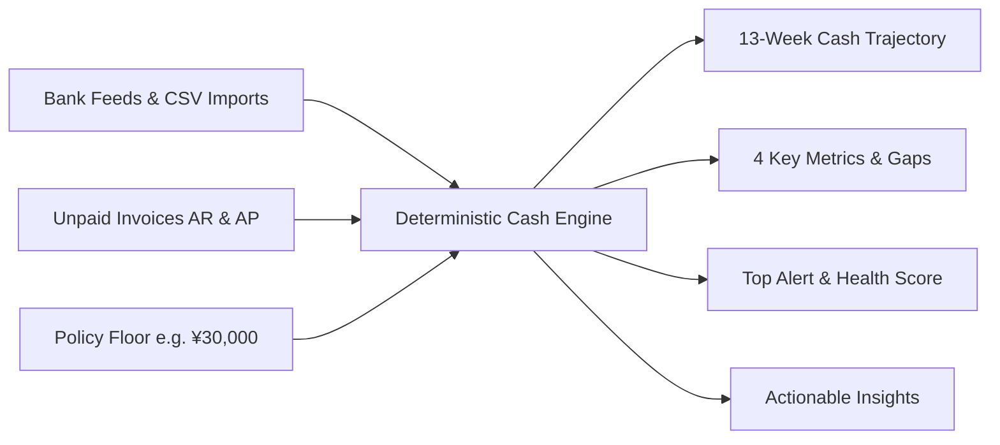
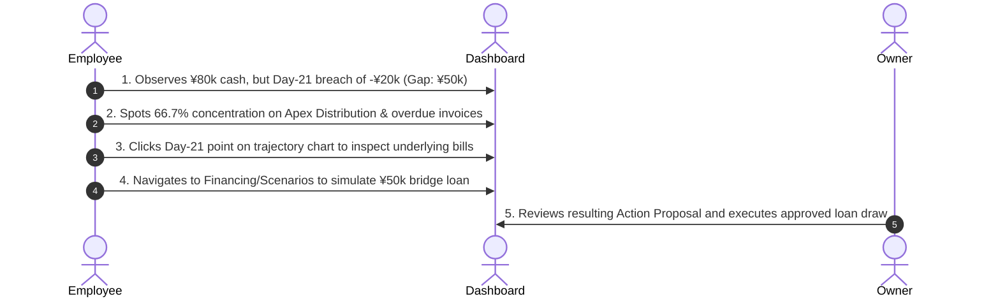

# HarborCFO Dashboard: Comprehensive Executive & Technical Guide

This document provides a complete, presentation-ready overview of the **HarborCFO Business Dashboard**. It is designed for company owners, operators, financial employees, and pitch presentations to explain what happens on the dashboard, how the numbers are calculated, what actions can be taken, and how different roles interact with it.

---

## 1. Executive Summary & Core Purpose

The HarborCFO Dashboard is the **central financial nervous system** for small and medium enterprises (SMEs). Rather than presenting static accounting reports after month-end, the dashboard computes a **deterministic, forward-looking 91-day cash projection** from real bank statements and unpaid invoices.



### Key Value Propositions
- **Zero Hallucination**: No AI estimates or probabilistic guessing in financial balances. Every number traces back to specific bank transactions or invoices.
- **Early Warning System**: Identifies cash shortfalls weeks before they occur (e.g., detecting a Day-21 cash breach on Day 1).
- **Plain Language Accessibility**: Non-technical business owners can switch between standard financial terminology and plain English with one click.

---

## 2. Owner vs. Employee: Roles & Capabilities

The dashboard serves both business owners and employees with role-aware permissions:

| Capability / Section | Company Owner | Company Employee | Real-World Context |
| :--- | :---: | :---: | :--- |
| **View Dashboard, Metrics & Trajectory** | Full Access | Full Access | Both need real-time situational awareness of cash position. |
| **Drill Down into Days / Weeks** | Full Access | Full Access | Employee can inspect individual transaction lines causing cash dips. |
| **Inspect Formulas & Source Proof** | Full Access | Full Access | Transparency for internal auditing and cross-checking invoices. |
| **Plain Language Toggle** | Full Access | Full Access | Non-financial team members can read numbers in simple terms. |
| **Upload Data to Refresh Dashboard** | Full Access | Full Access | Employee uploads new bank statements or invoice batches (`/imports`). |
| **Run What-If Scenarios** | Full Access | Full Access | Employee models solutions (e.g., "What if customer pays early?"). |
| **Propose Financing Solutions** | Full Access | Full Access | Employee drafts a loan or revolver proposal to bridge a cash gap. |
| **Approve & Execute Financing** | **Owner Only** | Read-Only | Only company owners hold legal authority to borrow money or sign contracts. |
| **Team Management & Settings** | **Owner Only** | Read-Only | Owners invite employees and configure safety liquidity floors. |

> [!NOTE]
> **Why this matters for your presentation**: Employees act as **operators** who diagnose issues, import data, and simulate solutions; Owners act as **approvers** who hold final fiduciary authority.

---

## 3. Detailed Component Breakdown

### 3.1 Welcome Banner (`WelcomeBanner`)
- **What it does**: Dynamically greets the user based on local time (`Good morning / afternoon / evening, [First Name]! 👋`).
- **Quick-Action Shortcuts**: Provides instant navigation to high-frequency workflows:
  - `Check Cash Forecast` (`/forecast`)
  - `View Alerts` (`/alerts`)
  - `Upload New Data` (`/imports`)
- **Use Case**: Eliminates cognitive friction for busy business owners, giving immediate direction upon login.

---

### 3.2 Top Alert Banner (`TopAlertBanner`)
- **What it does**: Evaluates all active system alerts and bubbles up the single highest-severity issue (`Critical` > `High` > `Medium` > `Info`).
- **Visual Cues**:
  - **Red Banner**: Critical liquidity breach imminent (e.g., projected cash dipping below zero or breaching the liquidity floor).
  - **Amber Banner**: High warning (e.g., customer concentration risk or significant overdue receivables).
- **CTA**: Single click on "View Alerts" leads directly to the full alerts triaging workspace.

---

### 3.3 The 4 Key Metric Cards (`CashSummaryCards`)

These four cards provide the fundamental health indicators of the business:

```
┌────────────────────────┐  ┌────────────────────────┐  ┌────────────────────────┐  ┌────────────────────────┐
│      CURRENT CASH      │  │    LIQUIDITY FLOOR     │  │  LOWEST PROJECTED CASH │  │      GAP TO FLOOR      │
│      ¥80,000.00        │  │      ¥30,000.00        │  │     -¥20,000.00        │  │       ¥50,000.00       │
│  As of 2026-10-20      │  │  Minimum Safety Buffer │  │  Projected on Day 21   │  │  Required Funding Gap  │
└────────────────────────┘  └────────────────────────┘  └────────────────────────┘  └────────────────────────┘
```

1. **Current Cash**:
   - **Definition**: Exact reconciled cash currently in company bank accounts.
   - **Formula**: `Starting Bank Balance + Cleared Inflows - Cleared Outflows`.
   - **Formula Inspector**: Clicking the info icon reveals the mathematical proof and linked ledger.
2. **Liquidity Floor**:
   - **Definition**: The business owner's minimum safety reserve policy. The business should never drop below this threshold.
   - **Plain Language Name**: *Emergency Cash Buffer*.
3. **Lowest Projected Cash**:
   - **Definition**: The lowest point cash will reach within the 91-day horizon based on known invoice due dates and recurring commitments.
   - **Example**: In our reference company, cash drops to `-¥20,000` on Day 21 (November 10, 2026).
4. **Gap to Floor**:
   - **Definition**: The exact amount of money needed to avoid dipping below the safety floor.
   - **Formula**: `Gap = Liquidity Floor - Min(Projected Cash)`.
   - **Example**: `¥30,000 - (-¥20,000) = ¥50,000`. The company needs exactly `¥50,000` in financing or accelerated collections to stay safe.

---

### 3.4 13-Week Cash Trajectory Chart (`CashCurveChart`)

The visual centerpiece of the dashboard.

```
 Cash (¥)
   ▲
100k │   ●
 80k │──/─\───────────────────────────── Current Cash (¥80k)
 60k │     \
 40k │      \
 30k │ - - - \ - - - - - - - - - - - - - Safety Floor (¥30k)
  0k ┼────────\───────/───────────────── Zero Line
-20k │         ●─────/                  Lowest Point (-¥20k on Day 21)
     └─────────┬──────┬───────► Time (13 Weeks)
             Week 3  Week 7
```

- **Solid Blue Line**: Projected weekly closing cash balance across 13 weeks.
- **Dashed Amber Line**: The company's liquidity floor policy (`¥30,000`). Any time the blue line drops below this line, the company is in violation of its safety policy.
- **Solid Gray Zero Line**: Insolvency boundary. If cash crosses below zero, the business cannot pay checks without an overdraft or external credit.
- **Interactivity**: Clicking on any data point in the chart navigates to `/forecast?date=YYYY-MM-DD`, allowing the user to drill down and see the exact invoices due on that day.
- **Accessibility**: Includes a hidden screen-reader narrative table (`AccessibleChartSummary`) for inclusive accessibility and compliance.

---

### 3.5 Deterministic Key Takeaways & Actions (`InsightsList`)

Rather than relying on generative AI (which can hallucinate financial figures), HarborCFO uses a **deterministic rules engine** to generate three actionable conclusions:

1. **Liquidity Status**:
   - *Standard*: *"Cash first falls below the floor on 10 Nov."*
   - *Plain English*: *"We will run short of cash on 10 Nov. We need ¥50,000.00 to stay safe."*
2. **Customer Concentration**:
   - *Standard*: *"Apex Distribution Ltd represents 66.7% of receivables (exceeds 40.0% threshold)."*
   - *Plain English*: *"Too much money is owed by one customer: Apex Distribution Ltd owes 66.7% of our unpaid invoices."*
3. **Overdue Receivables**:
   - *Standard*: *"¥15,000.00 is overdue in the 1–30 day bucket."*
   - *Plain English*: *"¥15,000.00 is late. We should chase these overdue payments right away."*

Users can toggle **Plain Language: On/Off** with a dedicated button on the card.

---

### 3.6 Accounts Receivable & Payable Aging Schedule (`AgingCard`)

Partitions outstanding obligations into standardized 30-day cohorts:
- **Tabs**: Switch between **Receivables (AR)** (money owed to us) and **Payables (AP)** (money we owe vendors).
- **Cohorts**:
  - `Current (Not Due)`
  - `1 – 30 Days Past Due` (highlighted in amber if non-zero)
  - `31 – 60 Days Past Due`
  - `61 – 90 Days Past Due`
  - `> 90 Days Past Due` (severe default risk)
- **Use Case**: Helps employees prioritize credit control and debt collections. If the 1–30 day bucket is high, collecting those invoices can eliminate the cash gap without borrowing.

---

### 3.7 Customer Concentration Risk (`ConcentrationCard`)

Credit risk is heavily influenced by counterparty dependency:
- **Metric**: Percentage of total outstanding receivables owed by the single largest client.
- **Visual Indicator**: Color-coded progress bar (Green if under policy threshold, Red if exceeded).
- **Numerator & Denominator**: Clearly displays the exact math:
  - *Numerator*: `Top Customer AR = ¥80,000.00`
  - *Denominator*: `Total AR = ¥120,000.00`
  - *Result*: `66.7%` (Policy threshold is `40.0%`).
- **Business Implication**: If this single customer delays payment, the company suffers immediate liquidity distress.

---

### 3.8 Data Freshness Card (`DataFreshnessCard`)
- **Status Indicator**:
  - `Up to Date` (Green): Latest bank and invoice feeds are reconciled.
  - `Stale` (Amber): Transactions have changed in the ledger since the last projection.
- **Action Link**: Direct link to `/imports` to upload fresh bank statements or invoice CSVs.

---

### 3.9 Financial Health Score (`HealthScoreCard`)
- **Score (0 to 100)**: Composite index evaluating cash runway, customer concentration, and payment punctuality.
- **Rating**: Qualitative rating (e.g., `82 / 100 (Healthy)` or `45 / 100 (At Risk)`).
- **Graceful Degradation & Zero-Data State**:
  - **Awaiting Data Import**: When a company workspace has zero committed transactions or invoices on file (`lastImportAt = null`), the card renders an empty state (`— / Awaiting Data Import`) with an actionable prompt linking to `/imports`, avoiding premature mathematical scoring before records exist.
  - If backend analytics are unavailable or loading, the component hides automatically without cluttering the UI.

---

### 3.10 Plain Language Mode (`PlainLanguageToggle`)
Located at the top-right of the dashboard, this toggle transforms technical financial jargon into intuitive SME language across all cards:

| Financial Jargon | Plain Business Language |
| :--- | :--- |
| **Liquidity Floor** | Emergency Cash Buffer |
| **Liquidity Gap** | Cash Shortage to Cover |
| **AR Aging** | Overdue Invoices Timeline |
| **Customer Concentration** | Top Customer Dependency |
| **Days Sales Outstanding (DSO)** | Days to Collect Invoices |
| **Burn Rate** | Monthly Net Cash Outflow |

---

## 4. End-to-End Walkthrough Scenario (Presentation Story)

When presenting to judges or training teammates, use this 5-step storyline:



1. **Observe (The Crisis)**:
   - On the surface, the business looks healthy with **¥80,000.00** current cash.
   - However, the **13-Week Cash Trajectory** reveals that on **Day 21**, cash plummets to **-¥20,000.00**, breaching the **¥30,000.00** floor.
   - The **Gap to Floor** shows an exact capital shortfall of **¥50,000.00**.

2. **Diagnose (Root Cause)**:
   - The **Customer Concentration Card** flags that **Apex Distribution Ltd** represents **66.7%** of all receivables.
   - The **Aging Card** shows that several invoices are already in the **1–30 Days Past Due** bucket.

3. **Explore Solutions (Operator/Employee Action)**:
   - The employee clicks the **Check Cash Forecast** link or the **Day 21 chart point** to see the daily ledger breakdown.
   - The employee goes to **Financing Options** (`/financing`) to compare borrowing facilities (e.g., Revolver vs. Bridge Loan vs. Invoice Factoring).
   - In **Scenarios** (`/scenarios`), the employee simulates taking a ¥50,000 bridge loan and sees the blue trajectory line lift above the safety floor.

4. **Propose & Sign-Off (Owner Action)**:
   - The employee drafts an **Action Proposal** (`/actions`).
   - The **Owner** logs in, reviews the proposal impact, and clicks **Approve & Execute Action**.
   - The dashboard updates immediately, showing the cash gap resolved and the business fully protected.

---

## 5. Quick Reference for Pitch Presentations

If you have 60 seconds to explain the dashboard in a pitch:
> *"HarborCFO replaces month-end hindsight with a forward-looking 91-day financial cockpit. Right on this dashboard, a business owner or accountant instantly sees their current bank cash, their safety buffer, and the exact day their cash will dip below policy.*
> 
> *Here, while the company has ¥80,000 today, our chart warns that cash will fall to -¥20,000 in three weeks due to high customer concentration. The system calculates the exact ¥50,000 gap required to protect the company. With our Plain Language toggle, any non-financial owner understands this immediately. Employees can simulate solutions, while only authorized owners can approve financial actions."*
