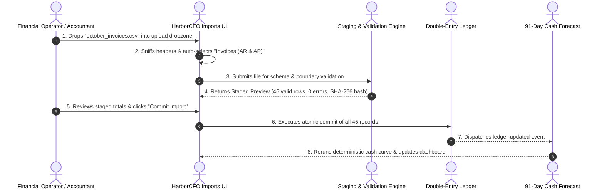

# HarborCFO Data Imports: Comprehensive Executive & Technical Guide

This document provides a complete, presentation-ready overview of the **HarborCFO Data Imports Feature** (`/imports`). It is designed for company owners, financial operators, employees, and pitch presentations to explain how financial data enters HarborCFO, how atomic validation protects company ledgers from corruption, what each UI component does, and how different roles interact with the system.

---

## 1. Executive Summary & Core Purpose

In corporate finance, **"garbage in, garbage out"** is the single greatest risk. If corrupted bank statements or misformatted invoices are loaded into an accounting system, cash forecasts hallucinate and automated decision-making fails.

HarborCFO eliminates this risk through a **zero-fault, atomic data ingestion gateway**. Rather than blindly accepting CSVs or writing partial records into database tables, every file undergoes strict pre-flight schema validation, header sniffing, and cryptographic deduplication before a single row touches the financial ledger.

```mermaid
flowchart TD
    A["Raw Bank / Invoice CSV File"] --> B["Client Pre-Validation & Header Sniffing"]
    B --> C["Staging Engine (In-Memory Validation & Checksum)"]
    C -->|Errors Found| D["Atomic Rejection (0 rows imported, Error CSV generated)"]
    C -->|Schema Valid| E["Staged Preview (First 10 rows, non-blocking warnings)"]
    E -->|User Confirms Commit| F["Cryptographic Idempotency Check (SHA-256)"]
    F -->|Duplicate Detected (409)| G["Conflict Warning (Existing Import ID displayed)"]
    F -->|Fresh File| H["Atomic Ledger Write (Double-entry sync)"]
    H --> I["Downstream Recalculations: 91-Day Forecast & Risk Alerts"]
```

### Key Value Propositions
- **All-or-Nothing Atomic Guarantee**: If a 5,000-row file has even a single invalid currency or malformed date on row 4,999, **zero rows are written**. The database is never left in a corrupted or half-imported state.
- **Cryptographic Deduplication (SHA-256)**: Every uploaded file is hashed. If an accountant accidentally re-uploads last week's bank statement, the system catches the collision and blocks duplicate double-counting.
- **Smart Header Sniffing**: Non-technical operators do not need to configure complex database mappings. HarborCFO samples the first 1 KB of file headers and automatically routes the data to either **Bank Transactions** or **Invoices**.
- **Instant Downstream Recalculation**: Once committed, the deterministic cash engine immediately triggers recalculations across the 13-Week Cash Curve, Runway projections, and Risk Alert monitoring.

---

## 2. Owner vs. Employee: Roles & Capabilities

HarborCFO balances **operational delegation** with **fiduciary control**:

| Capability / Action | Company Owner | Company Employee | Operational & Security Context |
| :--- | :---: | :---: | :--- |
| **Download Sample CSV Templates** | Full Access | Full Access | Employees need templates to prepare and format monthly data exports. |
| **Upload CSV & Inspect Staged Preview** | Full Access | Full Access | Operators can test files and preview how entries look before committing. |
| **Download Error Reports (CSV)** | Full Access | Full Access | Employees use annotated error logs to fix formatting issues offline. |
| **Commit Staged Records to Ledger** | **Full Access** | Restricted / Read-Only* | Writing entries to company books alters financial runway and risk posture. |
| **View Past Import History** | Full Access | Full Access | Full transparency for audit compliance and historical record tracing. |
| **Inspect Cryptographic Proofs (SHA-256)** | Full Access | Full Access | Verifies data integrity and proves exact file versions for auditors. |

*\*Note: When an account has read-only access (without `imports:write`), the upload dropzone and commit bar are automatically replaced with a friendly `ShieldAlert` notification, preserving full access to inspect past records and download error reports.*

---

## 3. Detailed Component Breakdown

```
ImportsPage (/imports)
├── PageHeader & PageIntro (Guidance, tips, dismissible local storage state)
└── ImportWorkspace (Main state machine & layout orchestrator)
    ├── Permission Notice (ShieldAlert for read-only accounts)
    ├── TemplateLinks (Downloadable CSV starter templates)
    ├── FileDropzone (Drag-and-drop, format & size check, auto-header sniffing)
    ├── PreviewTable (Staged data preview, summary stats, warning banner)
    ├── ErrorList (Atomic rejection table, error report CSV download)
    ├── CommitBar (Commit modal trigger, idempotency & expiry checks)
    ├── ImportSuccessPanel (Commit confirmation banner + fast-path links)
    └── ImportHistoryTable & ImportDetailsDialog (Audit log & cryptographic SHA-256 inspector)
```

---

### 3.1 Page Header & Friendly Onboarding (`PageHeader` & `PageIntro`)
- **File**: `apps/web/src/app/(app)/imports/page.tsx` & `apps/web/src/components/layout/page-intro.tsx`
- **What it does**: Welcomes the user with plain-language context, eliminating anxiety around uploading sensitive financial files.
- **Key Elements**:
  - **Header Title**: *"Import Your Data — Upload your bank statements and invoices as CSV files to keep your financial picture up to date."*
  - **Dismissible Help Card (`PageIntro`)**:
    - **Persistence Key**: `harbor_intro_imports` (stored in browser `localStorage` so dismissed intros do not re-appear).
    - **Icon**: `FileSpreadsheet`.
    - **Practical Tips**:
      1. *"Download the sample template first to see the expected format."*
      2. *"Dates can be in YYYY-MM-DD or MM/DD/YYYY format."*
      3. *"If there are any errors, we'll show you exactly which rows need fixing."*

---

### 3.2 Starter Template Downloader (`TemplateLinks`)
- **File**: `apps/web/src/features/imports/components/template-links.tsx`
- **What it does**: Provides standard CSV template downloads with valid headers and sample rows.
- **Available Templates**:
  1. **Bank Transactions CSV (`transactions-template.csv`)**:
     - **Headers**: `externalId,date,accountId,amount,currency,category,description`
     - **Sample Rows**: Inflow receipts (`customer_receipt`), operational overhead (`overhead`), and rent lease payments (`rent`) with signed positive/negative decimals.
  2. **Invoices CSV (`invoices-template.csv`)**:
     - **Headers**: `invoiceId,direction,counterpartyId,total,outstanding,currency,dueDate,expectedSettlementDate,status`
     - **Sample Rows**: AR customer receivables (`open`), AP supplier payables (`open`), and settled invoices (`paid`).
- **Technical Implementation**: Generated entirely client-side via `Blob` (`text/csv;charset=utf-8;`) so downloads are instantaneous without round-trip server latency.

---

### 3.3 Smart File Dropzone (`FileDropzone`)
- **File**: `apps/web/src/features/imports/components/file-dropzone.tsx`
- **What it does**: Accepts files via click-to-browse or drag-and-drop, validates file integrity, and automatically determines data type.
- **Key Capabilities**:
  - **Record Type Radio Selector**: Allows manual toggling between **Bank Transactions** (*Historical ledger entries & flows*) and **Invoices (AR & AP)** (*Receivables & payables ledger*).
  - **Intelligent Header Sniffing**:
    - When a user drops a file, HarborCFO reads the first 1,024 bytes in memory.
    - If the header row contains `invoiceid` or `counterpartyid`, the UI automatically switches mode to **Invoices**.
    - If the header row contains `accountid` or `category`, the UI switches to **Bank Transactions**.
    - Emits a non-intrusive Sonner toast notification (e.g., *"Auto-detected Invoice CSV headers; switched mode to Invoices"*).
  - **Pre-Upload Validation Constraints**:
    - **Extension Guard**: Rejects non-`.csv` files with an instant alert: *"Invalid file type: Only .csv files are supported."*
    - **Size Guard**: Enforces `IMPORT_LIMITS.MAX_FILE_BYTES` (5 MB / max ~10,000 rows).
  - **Visual Interactive States**:
    - *Idle*: Clean dashed border with `UploadCloud` icon.
    - *Drag-Active*: High-contrast highlight (`border-primary bg-primary/10`) and slight scale enlargement.
    - *Parsing / Uploading*: Disabled dropzone with spinning `RefreshCw` icon (*"Validating & generating preview..."*).
    - *File Selected*: Shows file name, size in KB, and a *"Clear / Select another file"* button.

---

### 3.4 Staged Preview Table (`PreviewTable`)
- **File**: `apps/web/src/features/imports/components/preview-table.tsx`
- **What it does**: Displays the parsed, staged data returned by the backend preview API before any changes are committed to disk.
- **Key Sections**:
  - **Staging Summary Header**:
    - Displays `CheckCircle2`, the record type badge (`transactions` or `invoices`), total parsed rows, and accepted rows count.
    - Displays a warning badge if non-blocking discrepancies were identified.
  - **Non-Blocking Warnings Callout**:
    - Amber banner explaining non-fatal warnings (e.g., an invoice counterparty that does not have custom credit terms will use default 30-day settlement).
    - Lists specific rows and fields: `Row 4 [expectedSettlementDate]: Defaulting to due date`.
  - **Sample Rows Table (First 10 Staged Records)**:
    - **Transactions View**: Displays `External ID`, `Date`, `Account`, `Category` (pill badge), formatted `Amount` (`Money` component with positive/negative color coding), and `Description`.
    - **Invoices View**: Displays `Invoice ID`, `Direction` (`AR` vs `AP` badge), `Counterparty`, `Due Date`, `Status` (`open`, `partially_paid`, `paid`), and `Total` / `Outstanding` amounts.

---

### 3.5 Atomic Rejection & Error List (`ErrorList`)
- **File**: `apps/web/src/features/imports/components/error-list.tsx`
- **What it does**: Renders when any row violates schema or domain constraints.
- **Key Elements**:
  - **Rejection Banner**:
    - High-visibility red card displaying `XCircle`, the total error count (e.g., *"Import Validation Rejected (3 Errors)"*), and target file name.
  - **All-or-Nothing Guarantee Callout**:
    - *"Nothing was imported. Imports in HarborCFO are completely atomic. Because validation errors were detected, no transactions or invoices have been committed to the ledger. Fix the errors below and re-upload."*
  - **Error Breakdown Table**:
    - `Row #`: Exact CSV row number (e.g., `Row 14`).
    - `Column / Field`: Target CSV column (e.g., `amount`, `dueDate`, `currency`).
    - `Validation Error Message`: Clear, human-readable reason (e.g., *"Amount must be a valid non-zero decimal number"*, *"Expected currency code CNY or USD"*).
  - **Download Error Report (CSV)**:
    - Generates a downloadable CSV containing all failed rows and error reasons so accountants can correct entries in Excel or Google Sheets.
  - **Reset Action**: Provides an instant *"Choose a Different File"* button to return to the dropzone.

---

### 3.6 Commit Execution Bar (`CommitBar`)
- **File**: `apps/web/src/features/imports/components/commit-bar.tsx`
- **What it does**: Executes the atomic transaction writing staged records into company ledgers.
- **Key Elements & Handlers**:
  - **Controls**:
    - `Discard`: Clears the staged preview without writing anything.
    - `Commit Import`: Opens the confirmation modal.
  - **Confirmation Dialog (`Dialog`)**:
    - Summarizes: *"Are you sure you want to commit X rows from [fileName]?"*
    - Outlines impact: *"This action will atomically write X records to your company's ledger. Recalculations for cash forecast and risk alerts will immediately trigger."*
  - **Edge-Case Handlers**:
    - **Duplicate File Detection (HTTP 409 Conflict)**: If the SHA-256 hash matches an earlier import, shows a warning: *"Duplicate File Detected — Idempotency guarantees prevent importing duplicate transactions or invoices"* with the existing Import ID.
    - **Preview Expiry (HTTP 410 Gone)**: Staged previews automatically expire after 1 hour. If expired, prompts the user to re-upload for fresh staging.

---

### 3.7 Import Success Panel (`ImportSuccessPanel`)
- **File**: Rendered in `apps/web/src/features/imports/components/import-workspace.tsx`
- **What it does**: Provides immediate positive confirmation once records are written to the database.
- **Key Elements**:
  - **Emerald Success Banner**:
    - Displays `CheckCircle2` and text: *"Atomically committed **{acceptedRows}** records from **{fileName}** into your **{kind}** ledger."*
  - **Direct Next-Step CTAs**:
    - **"Upload Another File"**: Clears state to import the next batch (e.g., uploading Invoices right after Bank Transactions).
    - **"View Updated Forecast"** (`/forecast`): Direct navigation to inspect the newly recalculated 13-week trajectory and runway.
    - **"View Risk Alerts"** (`/alerts`): Direct navigation to see if newly loaded invoices resolved cash shortages or flagged customer concentration risks.

---

### 3.8 Audit Trail & History Table (`ImportHistoryTable`)
- **File**: `apps/web/src/features/imports/components/import-history-table.tsx`
- **What it does**: Renders an immutable audit log of all past import attempts.
- **Table Columns**:
  1. `File Name`: Name of uploaded CSV file.
  2. `Kind`: Badge indicating `transactions` or `invoices`.
  3. `Status`:
     - `Committed` (Green): Written to ledger.
     - `Rejected` (Red): Blocked by schema validation.
     - `Previewed` (Amber): Staged in memory.
     - `Expired` (Gray): Staged session timed out.
  4. `Rows (Acc/Rej)`: Accepted count vs. rejected count (e.g., `52 / 0 (tot 52)`).
  5. `Date`: Formatted timestamp (e.g., `Oct 20, 02:45 PM`).
  6. `Actor`: Truncated ID of the user or `system` who initiated the import.
  7. `Actions`:
     - `Details` button: Opens the full cryptographic audit modal.
     - `Errors` button (only visible if rejected rows > 0): One-click download of the error CSV.
     - `Delete` button (Owner only): Allows the workspace Owner to delete/undo an import. When confirmed via the safety dialog, all ledger entries or invoices associated with that import batch are permanently purged from the database, the dataset version is incremented, and cash forecasts, runways, and risk alerts are immediately recalculated.
  - **Live Controls**: Includes a `Refresh` button with spin animation to re-fetch ledger import records.

---

### 3.9 Cryptographic Audit Inspector (`ImportDetailsDialog`)
- **File**: `apps/web/src/features/imports/components/import-details-dialog.tsx`
- **What it does**: A modal dialog providing deep audit verification for any selected row in the history table.
- **Key Sections**:
  - **Metric Stat Tiles**: Four stat boxes showing **Total Rows**, **Accepted**, **Rejected**, and **Mapping Version** (e.g., `v1`).
  - **Audit Breakdown**:
    - `Import ID`: Unique UUID identifier.
    - `Actor / Uploader`: User ID of the uploader.
    - `Uploaded Date` & `Committed Date`: Complete timestamps.
    - `Expires At`: Staging TTL timestamp.
    - `SHA-256 Checksum`: Cryptographic hash of the raw file content guaranteeing data integrity and non-repudiation.
  - **Status Banners**:
    - If committed: Confirms ledger synchronization and double-entry booking.
    - If rejected: Confirms that zero rows were written in accordance with zero-fault SME integrity.
  - **Inline Error Table**: Scrollable table listing all detected errors directly in the modal, plus an `Export Errors` button.
  - **Owner Undo / Delete Action**: Workspace Owners can initiate import deletion directly from the audit modal, closing the modal and launching the cascade deletion workflow.

---

### 3.10 Read-Only Permission Guard (`ShieldAlert`)
- **File**: Rendered in `apps/web/src/features/imports/components/import-workspace.tsx`
- **What it does**: Safeguards company records when viewed by non-admin or read-only team members.
- **Visual Presentation**:
  - Replaces the upload dropzone and commit bar with an elegant muted banner:
    > *"Read-Only Access: Your account has Reviewer permissions. You can inspect historical imports, error reports, and audit trails below, but cannot upload or commit new data files."*
  - Read-only users can still search the history table, open audit dialogs, and download past error reports for auditing.

---

## 4. End-to-End Walkthrough Scenario (Presentation Story)

When explaining HarborCFO’s data ingestion to judges or training teammates, use this 5-step storyline:



1. **Upload & Auto-Classification**:
   - The operator downloads the invoice template or exports receivables from their existing ERP.
   - The operator drags `october_invoices.csv` into the dropzone. HarborCFO sniffs the headers, detects `invoiceId` and `counterpartyId`, and automatically selects the Invoice ledger mode.
2. **Schema & Integrity Verification**:
   - The file is evaluated against strict boundary limits (dates must be valid, amounts must be non-zero numbers, currencies must match supported codes).
   - If an error is detected, HarborCFO rejects the upload with an atomic guarantee, displaying the exact row number and providing an error CSV download.
3. **Staged Inspection**:
   - Because the file is clean, the **Preview Table** appears, displaying the first 10 rows formatted with currency badges, payment directions (AR vs. AP), and non-blocking warnings.
4. **Atomic Commit & Idempotency Check**:
   - The operator clicks **Commit Import**. HarborCFO calculates the SHA-256 hash.
   - If the file was previously committed, it catches the duplicate (HTTP 409) and prevents double-counting.
   - For a fresh file, it atomically writes all 45 records into the company ledger.
5. **Instant Financial Impact**:
   - The **Success Panel** displays a green confirmation.
   - The operator clicks **"View Updated Forecast"**, where the newly imported invoices immediately shift the 13-week cash curve and update the business runway.

---

## 5. Quick Reference for Pitch Presentations

If you have 60 seconds to explain the Imports feature in a pitch:

> *"In SME financial management, bad data produces bad decisions. Traditional software often allows corrupted spreadsheets to partially import, creating ghost balances and phantom cash gaps.*
> 
> *HarborCFO solves this with an atomic, zero-fault data ingestion engine. When a business operator drops in a bank statement or invoice file, our system automatically sniffs the headers, verifies every row against strict schema rules, and calculates a SHA-256 cryptographic hash.*
> 
> *If even one row is broken, zero rows are imported, and the operator gets an instant row-by-row error report to fix. If valid, the operator previews the staged entries and commits them in one click. Every import is permanently logged with an immutable audit trail, instantly recalculating the company's 91-day cash forecast without manual accounting overhead."*
