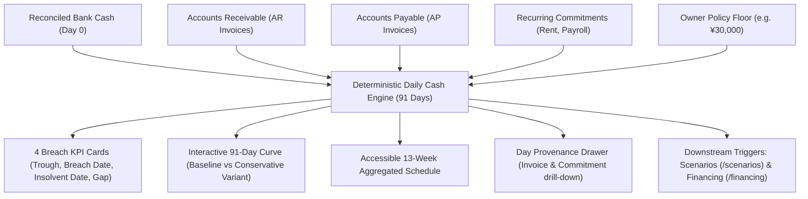
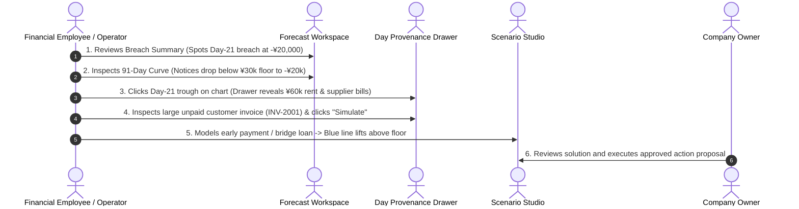

# HarborCFO Cash Forecast: Comprehensive Executive & Technical Guide

This document provides a complete, presentation-ready overview of the **HarborCFO Cash Forecast Feature** (`/forecast`). It is designed for company owners, financial operators, employees, and pitch presentations to explain how 91-day forward-looking cash flows are computed, how daily cash trajectories and policy floor breaches are identified, what each UI component does, and how different roles interact with the system.

---

## 1. Executive Summary & Core Purpose

In corporate finance, **82% of small and medium enterprise (SME) failures are caused by cash flow mismanagement**, not lack of profitability. A company can be highly profitable on paper while still going bankrupt because customer invoice payments arrive three weeks after supplier and payroll payments are due.

HarborCFO solves this through a **91-day (13-week) deterministic cash engine**. Rather than using speculative machine learning models or generative AI guessing, the forecast computes the exact future daily cash balance by combining:
1. Reconciled current bank cash balances.
2. Verified Accounts Receivable (AR) customer invoices mapped to expected settlement dates.
3. Verified Accounts Payable (AP) supplier invoices mapped to due dates.
4. Recurring operational commitments (payroll, rent, utility leases).
5. Approved financing drawdowns, facility fees, and repayment schedules.



### Key Value Propositions
- **Zero Hallucination Guarantee**: Every single dollar and cent in the projection traces directly to a specific invoice, commitment, or ledger entry.
- **Dual Projection Modes**:
  - **Baseline Closing Cash**: Expected trajectory based on scheduled invoice settlements.
  - **Conservative Assumption Variant**: Delays overdue receivables by an extra 14 days, revealing worst-case liquidity vulnerabilities without false statistical assumptions.
- **Early Runway Protection**: Detects a cash breach on Day 21 on Day 1, giving the business three full weeks to negotiate early collections or secure non-dilutive credit lines.
- **Deep Provenance Drilldown**: Clicking any point on the chart opens an itemized daily ledger sheet showing the exact invoices and commitments moving cash on that date.

---

## 2. Owner vs. Employee: Roles & Capabilities

The Forecast page is an operational workbench shared by operators and executives:

| Capability / Action | Company Owner | Company Employee | Operational & Decision Context |
| :--- | :---: | :---: | :--- |
| **Inspect 91-Day Cash Runway & Trajectory** | Full Access | Full Access | Both need shared situational awareness of future liquidity. |
| **Toggle Daily vs. Weekly Views** | Full Access | Full Access | Flexible high-level planning vs. micro-level day-to-day cash management. |
| **Drill Down into Daily Provenance Drawer** | Full Access | Full Access | Employees investigate which specific unpaid invoices cause a dip. |
| **Inspect Underlying Invoices & Commitments** | Full Access | Full Access | Operators review counterparty terms, due dates, and settlement status. |
| **Launch What-If Simulation from Invoice** | Full Access | Full Access | Employees test scenarios (e.g. *"What if Customer X pays 10 days early?"*). |
| **Configure Company Liquidity Floor** | **Owner Only** | Read-Only | Setting safety cash reserves (`/settings`) is an executive policy decision. |
| **Approve Financial Action Proposals** | **Owner Only** | Read-Only | Executing borrowing facilities (`/actions`) requires fiduciary signing authority. |

---

## 3. Detailed Component Breakdown

```
ForecastPage (/forecast)
├── PageIntro (Guidance, tips, dismissible local storage state)
└── ForecastView (Main state machine & layout orchestrator)
    ├── Subheader & Meta Banner ("Cash Runway & Trajectory", 91-day scope)
    ├── BreachSummary (4 KPI cards: Floor Breach, Insolvent Day, Trough, Liquidity Gap)
    ├── ForecastChart (Interactive Recharts curve, granularity toggle, reference lines)
    ├── AssumptionsPanel (Model boundaries, inclusions/exclusions, freshness indicator)
    ├── WeeklyTable (Accessible 13-week schedule with receipts, payments, min/closing cash)
    ├── DayDrilldownDrawer (Slide-over sheet with itemized day receipts, payments, financing)
    └── InvoiceDetailsDialog (Audit modal with counterparty details & "Simulate in Scenarios" CTA)
```

---

### 3.1 Page Header & Friendly Onboarding (`PageIntro`)
- **File**: `apps/web/src/app/(app)/forecast/page.tsx` & `apps/web/src/components/layout/page-intro.tsx`
- **What it does**: Provides non-intimidating orientation for business owners who may not be accustomed to reading financial charts.
- **Key Elements**:
  - **Storage Key**: `harbor_intro_forecast` (persisted in browser `localStorage`).
  - **Icon**: `TrendingUp` (`trending-up`).
  - **Plain-Language Title & Description**:
    - *"What is the Cash Forecast? — This page shows you exactly how much money your business will have each day for the next 3 months. It uses your real bank transactions and invoices to calculate this — no guessing involved."*
  - **Quick Tips**:
    1. *"Click any day on the chart to see exactly which payments come in or go out."*
    2. *"Red zones mean your cash drops below your safety target — time to take action!"*
    3. *"Use the Weekly Table view for a simpler week-by-week breakdown."*

---

### 3.2 Liquidity Breach Summary Cards (`BreachSummary`)
- **File**: `apps/web/src/features/forecast/components/breach-summary.tsx`
- **What it does**: Immediately flags whether the company will breach its policy floor or become insolvent over the next 91 days.
- **Two Visual States**:
  1. **Healthy State (`breach-summary-healthy`)**:
     - Green card with `CheckCircle2`: *"No Liquidity Breach Projected — Cash balance remains comfortably above policy floor (¥30,000.00) across the 91-day horizon."*
  2. **Breached State (`breach-summary-breached`)**:
     - Renders a 4-card KPI grid:

```
┌────────────────────────┐  ┌────────────────────────┐  ┌────────────────────────┐  ┌────────────────────────┐
│   FIRST FLOOR BREACH   │  │   FIRST INSOLVENT DAY  │  │  TROUGH (LOWEST CASH)  │  │     LIQUIDITY GAP      │
│       2026-11-10       │  │       2026-11-12       │  │      -¥20,000.00       │  │       ¥50,000.00       │
│ Dips below floor (¥30k)│  │ Drops below ¥0.00 cash │  │ Occurs on 2026-11-12   │  │ Funding to restore flr │
└────────────────────────┘  └────────────────────────┘  └────────────────────────┘  └────────────────────────┘
```

  - **1. First Floor Breach**: The earliest calendar date cash dips below the company's safety floor. Clicking the date automatically opens the day provenance drawer for that day.
  - **2. First Insolvent Day**: The earliest calendar date cash drops below zero (`¥0.00`), styled with high-contrast red warning styling (`AlertCircle`).
  - **3. Trough (Lowest Cash)**: The absolute lowest point cash reaches during the 91-day projection, showing both the trough value and the exact date it occurs.
  - **4. Liquidity Gap**: The exact capital shortfall required to maintain the safety reserve:
    $$\text{Liquidity Gap} = \text{Policy Floor} - \min(\text{Projected Cash})$$
    *Example: $\yen 30,000 - (-\yen 20,000) = \yen 50,000$.*

---

### 3.3 Interactive 91-Day Forecast Chart (`ForecastChart`)
- **File**: `apps/web/src/features/forecast/components/forecast-chart.tsx`
- **What it does**: The central graphical visualization of daily and weekly liquidity progression.
- **Core Elements & Visual Controls**:
  - **View Granularity Toggle (`ViewToggle`)**: Switches between **Daily (91 points)** and **Weekly (13 buckets)** modes.
  - **Baseline Closing Cash Line**:
    - Solid blue line (`#2563eb`, stroke width 2).
    - Custom conditional dots:
      - **Red dot**: Cash drops below zero (`isNegative`).
      - **Amber dot**: Cash drops below the policy floor (`isBelowFloor`).
  - **Conservative Assumption Variant Line**:
    - Dashed slate line (`#94a3b8`, stroke width 1.5, dash array `4 4`).
    - Models what happens if overdue receivables are delayed by an additional 14 days. Explicitly labeled: *"Conservative assumption: overdue receivables arrive 14 days later (not a statistical confidence band)"*.
  - **Policy Floor Reference Line**:
    - Dashed amber line (`#d97706`) anchored at the owner's safety floor (e.g. `¥30,000.00`).
  - **Zero Cash Reference Line**:
    - Dashed red line (`hsl(var(--destructive))`) anchored at `¥0.00`, marking the insolvency boundary.
  - **Selected Date Marker**:
    - Vertical purple/primary line marking the currently inspected date when a user clicks on the chart.
  - **Custom Hover Tooltip (`CustomTooltip`)**:
    - Displays Date/Week range, Baseline Closing Balance, Conservative Variant Balance, Policy Floor, and a prompt: *"Click point to view day drill-down"*.
  - **Screen-Reader Accessibility Table (`AccessibleChartSummary`)**:
    - Renders an invisible, semantic HTML table beneath the chart so users with screen readers can navigate weekly balances via assistive technology.

---

### 3.4 Model Boundaries & Freshness Panel (`AssumptionsPanel`)
- **File**: `apps/web/src/features/forecast/components/assumptions-panel.tsx`
- **What it does**: Demystifies the forecast by explicitly explaining what data is included and excluded, eliminating confusion for auditors and bankers.
- **Key Sections**:
  - **Freshness & Provenance Header**:
    - **As of Date**: e.g., `2026-10-20`.
    - **Data Version**: e.g., `v1` (increments whenever ledger transactions or invoices change).
    - **Stale Warning Badge**: Flashes amber if recent bank transactions have been imported since the last forecast run (*"Notice: Recent ledger entries or invoice changes have occurred... A re-forecast is pending event synchronization"*).
  - **Included in Projection (Deterministic)**:
    - Outstanding AR & AP invoices mapped to expected settlement dates.
    - Fixed recurring commitments (payroll, rent, scheduled overhead).
    - Approved sandbox financing drawdowns, facility fees, and installment schedules.
    - Conservative 14-day delay buffer for overdue collections.
  - **Excluded from Projection (Non-Speculative)**:
    - No unscheduled sales or speculative revenue projections.
    - No uncommitted or hypothetical loan offers before sandbox execution.
    - Pure mathematical calculation from verified records without generative guessing.

---

### 3.5 Accessible 13-Week Schedule Table (`WeeklyTable`)
- **File**: `apps/web/src/features/forecast/components/weekly-table.tsx`
- **What it does**: Translates the 91-day curve into a structured, tabular 13-week cash report favored by accountants and corporate lenders.
- **Table Structure**:
  1. `Week`: Label (`W1` to `W13`).
  2. `Date Range`: Start date to end date (`YYYY-MM-DD → YYYY-MM-DD`).
  3. `Receipts`: Total cash inflows scheduled during that week (green).
  4. `Payments`: Total cash outflows scheduled during that week (rose).
  5. `Min Balance`: Lowest cash reached during that 7-day period (bold red if negative).
  6. `Closing Balance`: Ending cash on the final day of the week (color-coded by health status).
  7. `Drill-Down`: "Details" button with `ArrowUpRight` icon to open the drawer for that week's ending date.

---

### 3.6 Day Provenance Drawer (`DayDrilldownDrawer`)
- **File**: `apps/web/src/features/forecast/components/day-drilldown-drawer.tsx`
- **What it does**: A slide-over right sheet (`Sheet`) that answers the most important question in finance: *"Why is cash going up or down on this specific day?"*
- **Key Sections**:
  - **Drawer Header**: Shows selected date (e.g. `2026-11-10`) and badge indicating *"Day Provenance"*.
  - **Projected Day-End Closing Cash**: Prominent summary card displaying final closing balance.
  - **Receipts (Inflows)**:
    - Green section listing every scheduled customer payment (`Receipt` icon, external invoice ID, counterparty name, and formatted amount).
  - **Payments (Outflows)**:
    - Rose section listing every vendor invoice (`Receipt` icon) or recurring operational expense (`FileText` icon, e.g. Monthly Rent or Payroll).
  - **Financing Schedule**:
    - Blue section displaying loan disbursements, facility fees, or debt repayments (`CreditCard` icon).
  - **Interactivity**: Clicking the `ExternalLink` icon next to any invoice opens the full `InvoiceDetailsDialog`. Clicking a commitment navigates to `/settings?tab=commitments`.

---

### 3.7 Invoice Audit Dialog (`InvoiceDetailsDialog`)
- **File**: `apps/web/src/features/forecast/components/invoice-details-dialog.tsx`
- **What it does**: A dedicated modal providing deep audit verification for an individual invoice appearing in the forecast.
- **Key Elements**:
  - **Direction & Status**: `Receivable (AR)` vs `Payable (AP)` badge + `open`, `partially_paid`, or `overdue` status.
  - **Scheduled Amount**: Formatted currency with positive/negative color coding.
  - **Metadata Grid**:
    - `Counterparty`: Legal customer or vendor identifier.
    - `Settlement Date`: Expected cash realization date.
    - `Due Date`: Contractual invoice deadline.
    - `Currency`: Reconciled operating currency (CNY).
  - **Forecast Provenance Note**: Explains whether the invoice uses standard settlement or includes a 14-day overdue delay buffer.
  - **Simulate in Scenarios Action (`Simulate in Scenarios`)**:
    - Direct CTA button with `Sparkles` icon that bridges the invoice directly to `/scenarios`.
    - Enables operators to immediately ask: *"What if this customer pays 10 days earlier?"* or *"What if we factor this invoice?"* and observe the impact on the cash curve.

---

## 4. End-to-End Walkthrough Scenario (Presentation Story)

When demonstrating the forecast to judges, bankers, or teammates, use this 5-step operational narrative:



1. **Spot the Crisis (Breach Cards)**:
   - The user opens `/forecast`. While current cash is healthy (¥80,000), the **Breach Summary** immediately flashes amber and red.
   - **First Floor Breach**: November 10, 2026.
   - **Trough**: `-¥20,000.00` on November 12, 2026.
   - **Liquidity Gap**: `¥50,000.00`.
2. **Analyze the Trajectory (Forecast Chart)**:
   - On the **91-Day Chart**, the user observes the blue baseline line declining steadily through Week 2 and plunging below the orange dashed floor line on Day 21.
   - The conservative dashed line shows that if overdue invoices slip further, the deficit deepens to `-¥35,000.00`.
3. **Investigate the Root Cause (Day Provenance Drawer)**:
   - The operator clicks directly on the trough date (`2026-11-12`) on the chart.
   - The slide-over drawer opens, revealing the culprits:
     - Outflow 1: `COMMIT-RENT` (¥12,000.00 monthly lease).
     - Outflow 2: `INV-2002` (¥18,000.00 supplier payment).
     - Outflow 3: Payroll commitment scheduled on the same date.
4. **Inspect Provenance & Cross-Navigate (Invoice Dialog)**:
   - The operator clicks the external link on an open receivable (`INV-2001`, ¥25,000.00 from Apex Distribution).
   - The **Invoice Audit Dialog** confirms the invoice is scheduled for settlement later in the month, leaving a temporary cash vacuum.
5. **Simulate the Fix**:
   - The operator clicks **"Simulate in Scenarios"**.
   - In `/scenarios`, they model taking a `¥50,000.00` short-term credit line or offering a 2% early payment discount.
   - The simulated trajectory updates in real time, lifting the cash curve safely above the `¥30,000.00` floor.
   - The operator creates an **Action Proposal** for the Owner to approve.

---

## 5. Quick Reference for Pitch Presentations

If you have 60 seconds to explain the Cash Forecast in a pitch:

> *"Cash flow failure is the number one killer of growing businesses. Accounting software only tells you what happened in the past, while spreadsheets are brittle and error-prone.*
> 
> *HarborCFO’s Forecast is a 91-day deterministic cash cockpit. Every day for the next 13 weeks, it calculates the exact cash balance down to the penny based on verified invoices, payroll, and rent commitments.*
> 
> *Here, our Breach Summary warns the owner that on Day 21, cash will breach their ¥30,000 safety floor and hit negative ¥20,000, creating an exact ¥50,000 gap. By clicking directly on the chart, an operator sees the exact supplier invoices and payroll causing the drop, and can simulate taking a bridge loan or offering early customer discounts.*
> 
> *There is zero AI hallucination. Every number is backed by verifiable provenance, giving owners the clarity they need to protect their runway weeks before a crisis hits."*
