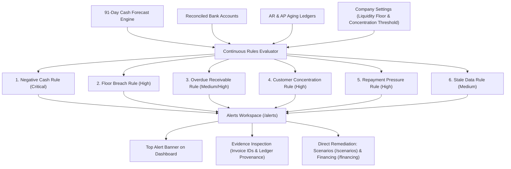

# HarborCFO Alerts & Notifications: Comprehensive Executive & Technical Guide

This document provides a complete, presentation-ready overview of the **HarborCFO Alerts & Notifications Feature** (`/alerts`). It is designed for company owners, financial operators, employees, and pitch presentations to explain how risk detection rules evaluate company solvency, how alerts are triggered deterministically, what each UI component does, and how different roles interact with the system.

---

## 1. Executive Summary & Core Purpose

In corporate financial risk management, **surprise is the enemy of survival**. Most SMEs discover liquidity crises when a payroll check bounces or a supplier freezes deliveries. 

HarborCFO’s Alerts Engine acts as an **autonomous, continuous financial watchdog**. Rather than relying on periodic manual audits, the system automatically evaluates company data against **6 deterministic risk detection rules** every time new transactions are imported, invoices change, or a day advances.



### Key Value Propositions
- **Deterministic Rules, Zero Probabilistic Noise**: Alerts are triggered by strict mathematical invariants (e.g., $AR_{\text{top}} / AR_{\text{total}} > 40\%$, or $\min(\text{Cash}) < 0$), not speculative AI hallucinations.
- **Traceable Evidence Chains**: Every alert displays the exact invoices, customer IDs, and bank figures that triggered it. An accountant can audit the exact reason in seconds.
- **Severity-Prioritized Triaging**: Automatically ranks threats into `Critical`, `High`, `Medium`, and `Info` cohorts, preventing alert fatigue and focusing executive attention where money is at risk.
- **Direct Cross-Feature Remediation**: Alerts do not just point out problems; they link directly into **Scenarios** and **Financing** to execute a fix.

---

## 2. Owner vs. Employee: Roles & Capabilities

The Alerts feature is an operational triaging center shared by both roles:

| Capability / Action | Company Owner | Company Employee | Operational & Decision Context |
| :--- | :---: | :---: | :--- |
| **View Active & Resolved Alerts** | Full Access | Full Access | Both need real-time situational awareness of all operational threats. |
| **Inspect Supporting Evidence & Invoices** | Full Access | Full Access | Operators examine specific invoice IDs, customer names, and due dates. |
| **Toggle Status Filters (Open vs Resolved)** | Full Access | Full Access | Operators audit past issues and verify whether risk conditions cleared. |
| **Trigger Immediate System Re-Evaluation** | Full Access | Full Access | Operators refresh alert rules immediately after importing fresh CSV files. |
| **Launch Scenarios to Fix Alerts** | Full Access | Full Access | Employees model solutions (e.g. testing receivables factoring in `/scenarios`). |
| **Configure Policy Thresholds (Floor/Limits)** | **Owner Only** | Read-Only | Changing concentration limits or floor buffers is an executive policy decision. |

---

## 3. The 6 Deterministic Risk Rules

HarborCFO continuously monitors company health across six distinct financial risk dimensions:

| Rule ID | Default Severity | Trigger Condition | Business Risk Explained |
| :--- | :---: | :--- | :--- |
| **`negative_cash`** | **Critical** (Red) | Projected cash dips below $\yen 0.00$ within the 91-day horizon. | **Imminent Insolvency**: The company will be legally unable to honor checks or bank transfers without credit. |
| **`floor_breach`** | **High** (Orange) | Projected cash dips below the owner's safety reserve floor. | **Policy Violation**: Operational safety buffer is violated, leaving the company vulnerable to unforeseen shocks. |
| **`customer_concentration`** | **High** (Orange) | A single customer represents $\ge 40\%$ of total outstanding receivables. | **Counterparty Fragility**: If this single customer defaults or delays payment, company cash flow collapses. |
| **`repayment_pressure`** | **High** (Orange) | Scheduled debt service & loan fees exceed available operating free cash. | **Debt Overhang**: Company risks defaulting on borrowing facilities or covenants. |
| **`overdue_receivable`** | **Medium** (Amber) | Unpaid customer invoices pass contractual due dates without settlement. | **Delayed Inflows**: Working capital is locked up in delinquent accounts, draining liquidity. |
| **`stale_data`** | **Medium** (Amber) | Bank ledger entries have changed since the last projection run. | **Information Asymmetry**: Decisions are being made on outdated forecast projections. |

---

## 4. Detailed Component Breakdown

```
AlertsPage (/alerts)
├── PageHeader & PageIntro (Plain language orientation, tips, dismissible state)
└── AlertsPanel (Main triaging workspace)
    ├── AlertFilters (Open vs Resolved tab toggles, counter badges)
    ├── Evaluation Timestamp & Live Refresh button
    ├── AlertCard (Severity-coded container, rule badges, timestamps)
    │   ├── SeverityBadge (Critical, High, Medium, Info)
    │   ├── AlertEvidenceList (Itemized invoices, counterparties, amounts)
    │   └── Cross-link Action CTAs (Launch Scenarios, Compare Financing)
    └── Empty States (No open alerts / Clean bill of financial health)
```

---

### 4.1 Page Header & Friendly Onboarding (`PageIntro`)
- **File**: `apps/web/src/app/(app)/alerts/page.tsx` & `apps/web/src/components/layout/page-intro.tsx`
- **What it does**: Explains alerts in reassuring, non-alarmist business language.
- **Key Elements**:
  - **Storage Key**: `harbor_intro_alerts` (persisted in browser `localStorage`).
  - **Icon**: `AlertTriangle` (`alert-triangle`).
  - **Plain-Language Title & Description**:
    - *"What are these alerts? — Alerts are automatic warnings about potential problems in your finances. We monitor your cash flow, overdue invoices, and customer concentration so you don't have to."*
  - **Practical Tips**:
    1. *"Critical alerts (red) need immediate action — like running out of cash soon."*
    2. *"Warnings (yellow) are things to keep an eye on."*
    3. *"You can acknowledge alerts to mark them as seen."*

---

### 4.2 Status Filter Bar & Evaluation Meta (`AlertFilters`)
- **File**: `apps/web/src/features/alerts/components/alert-filters.tsx` & `alerts-panel.tsx`
- **What it does**: Provides tabbed navigation between active issues and resolved historical alerts, with live audit metadata.
- **Key Elements**:
  - **Tab Buttons**:
    - **Open Issues**: Displays active unresolved threats with a count badge (e.g. `Open (3)`).
    - **Resolved**: Displays cleared threats where underlying financial conditions were rectified (e.g. `Resolved (1)`).
  - **Last Evaluated Timestamp**: Formatted time (e.g. `Evaluated: Oct 20, 02:45 PM`) showing exactly when the rules engine last inspected company ledgers.
  - **Live Refresh Button (`RefreshCw`)**: Triggers an on-demand re-evaluation of all 6 rules against the latest database state, with spin animation.

---

### 4.3 Severity-Coded Alert Cards (`AlertCard`)
- **File**: `apps/web/src/features/alerts/components/alert-card.tsx`
- **What it does**: Encapsulates a single detected issue with visual severity indicators, timestamps, summary text, and supporting evidence.
- **Card Structure**:
  - **Severity Border & Header**:
    - **Critical**: High-contrast red border (`border-red-500/40`) with `Critical` badge.
    - **High**: Orange border (`border-orange-500/40`) with `High` badge.
    - **Medium**: Amber border (`border-amber-500/40`) with `Medium` badge.
    - **Resolved**: Muted card with opacity 75% and green `Resolved` badge (`CheckCircle2`).
  - **Rule Identifier**: Monospace badge indicating the exact triggered rule (e.g., `floor breach`, `customer concentration`, `overdue receivable`).
  - **Time Tracking**:
    - `Last seen`: Shows recent confirmation timestamp.
    - Tooltip reveals `First detected` timestamp to measure duration of the threat.
  - **Plain-Language Title & Summary**:
    - Clear headline (e.g., *"Customer Concentration Exceeds Policy"*).
    - Plain-text summary detailing the business impact (e.g., *"Apex Distribution Ltd represents 66.7% of total receivables (¥80,000.00 / ¥120,000.00), exceeding your 40.0% safety threshold."*).

---

### 4.4 Supporting Evidence List (`AlertEvidenceList`)
- **File**: `apps/web/src/features/alerts/components/alert-evidence-list.tsx`
- **What it does**: Provides mathematical proof for the alert, listing the specific invoices, dates, or counterparty records involved.
- **Key Elements**:
  - **Evidence Items**:
    - `id`: Monospace code (e.g. `INV-2001`, `CUST-001`, or `2026-11-10`).
    - `label`: Human-readable description (e.g., *"Apex Distribution Ltd - Invoice #2001"*).
    - `amountMinor`: Formatted currency amount (e.g., `¥80,000.00`).
  - **Direct Drilldown Links**:
    - Links directly to `/forecast?date=YYYY-MM-DD` for cash breach dates.
    - Links to `/scenarios` to simulate factoring or delaying specific invoices.

---

### 4.5 Healthy / Zero-Alerts State
- **File**: Rendered in `apps/web/src/features/alerts/components/alerts-panel.tsx`
- **What it does**: Replaces the list with a positive confirmation when no open issues exist.
- **Elements**:
  - Displays `CheckCircle2` in a green-tinted card:
    > *"All Clear — No Open Alerts. All financial invariant checks, cash runway targets, and concentration limits are within policy."*

---

## 5. End-to-End Walkthrough Scenario (Presentation Story)

When presenting the Alerts feature, use this triaging scenario:

```mermaid
sequenceDiagram
    autonumber
    actor Employee as Financial Operator
    actor Alerts as Alerts Workspace (/alerts)
    actor Forecast as 91-Day Forecast
    actor Scenarios as Scenario Studio (/scenarios)
    actor Owner as Company Owner

    Employee->>Alerts: 1. Opens /alerts and spots Critical "Negative Cash" & High "Customer Concentration"
    Employee->>Alerts: 2. Inspects evidence on concentration alert (Apex Distribution owes ¥80,000)
    Employee->>Forecast: 3. Cross-navigates to Forecast to see cash dipping to -¥20,000 on Day 21
    Employee->>Scenarios: 4. Launches Scenario to model factoring Apex Distribution's invoice at 2% discount
    Employee->>Scenarios: 5. Confirms simulated cash lifts above floor; generates Action Proposal
    Owner->>Alerts: 6. Approves action; re-evaluates alerts -> "Negative Cash" alert marked Resolved
```

1. **Morning Triaging**:
   - The operator logs into HarborCFO and navigates to **Alerts & Notifications** (`/alerts`).
   - The filter shows **3 Open Issues**.
2. **Reviewing the Highest Threat**:
   - At the top of the stack is a **Critical Alert**: *"Projected Insolvency on Day 21 (November 10)"*.
   - Right below is a **High Alert**: *"Customer Concentration Risk — Apex Distribution Ltd represents 66.7% of receivables"*.
3. **Inspecting Evidence**:
   - The operator clicks the evidence chips on the concentration alert. It shows invoice `INV-2001` for `¥80,000.00` scheduled late in the month.
4. **Cross-Navigating to Remediate**:
   - The operator clicks **"Simulate in Scenarios"**.
   - In `/scenarios`, they model accelerating that invoice by 15 days via invoice factoring.
   - The simulated cash trajectory lifts safely above the floor.
5. **Resolution Verification**:
   - The owner executes the factoring proposal.
   - The operator returns to `/alerts` and clicks **Refresh**.
   - The **Negative Cash** alert moves from **Open** to **Resolved**, providing a permanent audit record.

---

## 6. Quick Reference for Pitch Presentations

If you have 60 seconds to explain the Alerts feature in a pitch:

> *"In business finance, you can't afford to discover problems when it's already too late. Most companies fail because of hidden counterparty dependency or unseen cash shortages.*
> 
> *HarborCFO’s Alerts engine continuously evaluates six deterministic risk rules against company ledgers. It immediately flags when projected cash dips below zero, when emergency safety floors are breached, or when a single customer owes more than 40% of all unpaid invoices.*
> 
> *Unlike generic dashboards, our alerts include verifiable mathematical evidence down to the exact invoice ID and customer name. Operators can click directly into Scenarios to simulate a solution, and once resolved, every alert is archived with a permanent audit trail. It’s an automated financial risk officer working 24/7."*
