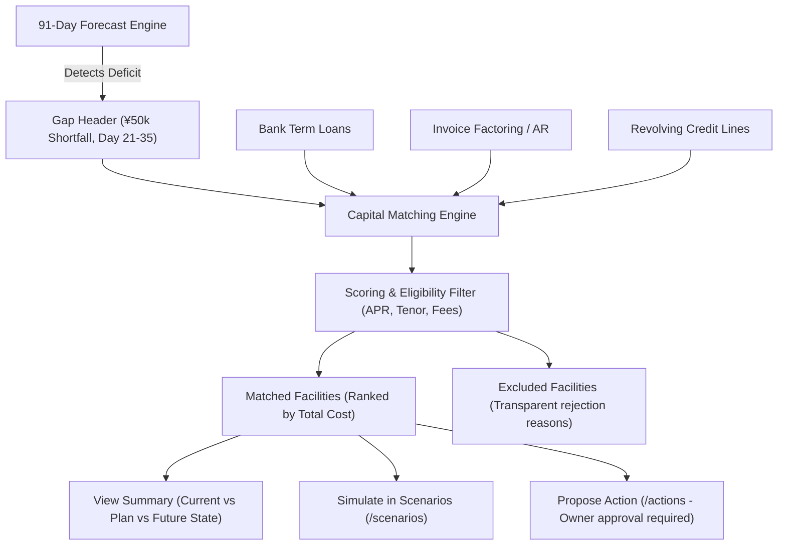

# HarborCFO Financing Options: Comprehensive Executive & Technical Guide

This document provides a complete, presentation-ready overview of the **HarborCFO Financing Options Feature** (`/financing`). It is designed for company owners, financial operators, employees, and pitch presentations to explain how borrowing facilities are matched to exact cash deficits, how credit costs and repayment terms are evaluated, what each UI component does, and how different roles interact with the system.

---

## 1. Executive Summary & Core Purpose

When small businesses run into cash shortages, they usually seek funding **in a state of panic**—taking whatever high-interest merchant cash advance or predatory loan is available. Conversely, banks reject small businesses because they lack clean, forward-looking visibility into their ability to repay.

HarborCFO bridges this gap with an **autonomous capital matching engine**. When the 91-day forecast detects a cash gap (e.g., $¥50,000$ on Day 21), the Financing engine:
1. Calculates the exact **capital shortfall** and the **deficit duration** (e.g. 14 days).
2. Evaluates the company’s real collateral (unpaid invoices, verified revenue).
3. Matches the business with appropriate credit facilities (Working Capital Loans, Invoice Factoring, Revolving Lines of Credit).
4. Models the exact **total cost of borrowing** and checks whether future cash flow can comfortably support debt service without causing a second liquidity crisis.



### Key Value Propositions
- **Precision Funding**: Borrow only what is needed for the exact number of days required, minimizing total interest expense.
- **Three-Pillar Facility Summary**: Every facility provides an instant 3-pillar breakdown: *Current State*, *Plan of Facility*, and *Projected State After Execution*.
- **Pre-Emptive Repayment Pressure Checking**: Ensures that taking a loan today does not create an even worse cash collapse when repayment installments come due.
- **Simulate Before Incurring Debt**: Seamlessly transfers loan parameters into the **Scenario Studio** (`/scenarios`) to preview the altered cash curve before proposing legal commitments.

---

## 2. Owner vs. Employee: Roles & Capabilities

Financing decisions require rigorous internal controls and clear role boundaries:

| Capability / Action | Company Owner | Company Employee | Operational & Legal Context |
| :--- | :---: | :---: | :--- |
| **Inspect Matched Financing Facilities** | Full Access | Full Access | Both examine options to solve upcoming liquidity shortfalls. |
| **Adjust Funding Controls (Amount/Tenor)** | Full Access | Full Access | Employees test different loan sizes and borrowing horizons. |
| **Inspect Facility Summary & Repayments** | Full Access | Full Access | Operators review APR, total fees, and monthly debt service schedules. |
| **Simulate Facilities in Scenarios** | Full Access | Full Access | Operators test how a facility lifts the blue cash trajectory line. |
| **Draft / Propose Financing Action** | Full Access | Full Access | Employees prepare a term sheet proposal for executive sign-off. |
| **Approve & Legally Execute Borrowing** | **Owner Only** | Read-Only | Taking commercial loans or pledging invoices requires legal owner authority. |

---

## 3. Supported Financing Facility Types

HarborCFO evaluates three core SME credit structures:

```
┌─────────────────────────────────┐  ┌─────────────────────────────────┐  ┌─────────────────────────────────┐
│     WORKING CAPITAL LOAN        │  │       INVOICE FACTORING         │  │     REVOLVING CREDIT LINE       │
│ Fixed term bridge credit        │  │ Immediate advance on AR billings│  │ Flexible draw-and-repay reserve │
│ • 1-time lump-sum disbursement  │  │ • Advances 80-90% of invoice face│  │ • Interest only on drawn balance │
│ • Predictable installment schedule│  │ • Liquidates on customer settlement│  │ • Reusable safety buffer       │
└─────────────────────────────────┘  └─────────────────────────────────┘  └─────────────────────────────────┘
```

1. **Working Capital Term Loan**:
   - *Best for*: Defined capital deficits (e.g. bridging inventory purchases or rent peaks).
   - *Cost Structure*: Fixed APR + upfront origination fee, amortized over 3 to 12 months.
2. **Invoice Factoring / AR Advance**:
   - *Best for*: Companies with high customer concentration or delayed receivables.
   - *Cost Structure*: Discount fee (e.g. 1.5%–3.0% per 30 days) deducted upon customer collection.
3. **Revolving Credit Line (Revolver)**:
   - *Best for*: Ongoing liquidity volatility and emergency safety reserves.
   - *Cost Structure*: Low commitment fee on total facility + interest only on active draws.

---

## 4. Detailed Component Breakdown

```
FinancingPage (/financing)
├── PageHeader & PageIntro (Plain language orientation, tips, dismissible state)
└── FinancingWorkspace (Main orchestrator)
    ├── GapHeader (Deficit amount, target window, policy shortfall)
    ├── MatchControls (Requested amount slider, tenor selection, filters)
    ├── Matched Facilities Grid (Cards ranked by matching score & cost)
    │   └── OfferCard
    │       ├── Facility Summary (Provider, limit, APR, fees, monthly debt)
    │       ├── Matching Score Badge (e.g. 94 / 100)
    │       ├── "View Summary" Button -> FacilitySummaryDialog
    │       ├── "Simulate in Scenarios" CTA
    │       └── "Request Term Sheet / Propose" Action Button
    ├── ExcludedOffers & CannotAssessOffers (Transparent rejection criteria)
    ├── ScheduleTable (Amortization schedule for active simulations)
    └── FinancingDisclaimer (Regulatory and credit underwriting notice)
```

---

### 4.1 Page Header & Friendly Guidance (`PageIntro`)
- **File**: `apps/web/src/app/(app)/financing/page.tsx` & `apps/web/src/components/layout/page-intro.tsx`
- **What it does**: Demystifies debt financing for non-financial founders.
- **Key Elements**:
  - **Storage Key**: `harbor_intro_financing` (persisted in browser `localStorage`).
  - **Icon**: `Landmark` (`landmark`).
  - **Plain-Language Title & Description**:
    - *"How does this work? — If your forecast shows a cash shortfall, this page shows you borrowing options that could help. Each option shows how much it costs, how long the loan is, and how it affects your cash flow."*
  - **Practical Tips**:
    1. *"Click 'Simulate' on any option to see how it changes your forecast."*
    2. *"Lower total cost is generally better — compare the 'Total Interest' column."*
    3. *"You can request a formal quote once you find an option you like."*

---

### 4.2 Liquidity Gap Header (`GapHeader`)
- **File**: `apps/web/src/features/financing/components/gap-header.tsx`
- **What it does**: Establishes the exact target funding requirement calculated by the cash forecast.
- **Key Metrics Displayed**:
  - **Required Funding Gap**: Exact shortfall to restore safety buffer (e.g. `¥50,000.00`).
  - **Deficit Window**: The calendar window where cash is compromised (e.g., `Nov 10 – Nov 24, 2026`).
  - **Lowest Cash Point**: Deepest projected deficit (e.g., `-¥20,000.00`).
  - **Pre-fill Action**: Automatically sets the default borrowing request slider to match the exact gap.

---

### 4.3 Capital Match Controls (`MatchControls`)
- **File**: `apps/web/src/features/financing/components/match-controls.tsx`
- **What it does**: Lets operators fine-tune the funding search parameters.
- **Controls**:
  - **Funding Amount Slider & Input**: Adjusts requested capital from $¥10,000$ to $¥500,000$.
  - **Tenor Selector**: Filters facilities by duration (e.g., 30 Days, 60 Days, 90 Days, 6 Months, 12 Months).
  - **Facility Type Filters**: Filter by Term Loans, Invoice Factoring, or Revolving Lines.

---

### 4.4 Facility Offer Cards (`OfferCard`)
- **File**: `apps/web/src/features/financing/components/offer-card.tsx`
- **What it does**: Displays an eligible credit facility with complete terms, transparent pricing, and action triggers.
- **Key Information Displayed**:
  - **Provider & Facility Name**: e.g., *"Working Capital Bridge Facility — Commercial Bank Partner"*.
  - **Matching Score Badge**: Algorithmic suitability score (e.g., `Score: 94/100`) based on cost, speed, and repayment alignment.
  - **Financial Terms Grid**:
    - `Max Facility Limit`: Maximum capital available (e.g. `¥100,000.00`).
    - `Annual Percentage Rate (APR)`: Transparent interest rate (e.g. `6.50% p.a.`).
    - `Total Fees & Interest`: Complete cost of borrowing over the full term (e.g. `¥1,250.00`).
    - `Estimated Monthly Repayment`: Principal + interest installment (e.g. `¥8,541.67 / mo`).
- **Action Buttons**:
  1. **"View Summary"**: Opens the 3-pillar executive summary modal.
  2. **"Simulate in Scenarios"**: Direct link to test the facility in `/scenarios`.
  3. **"Request Term Sheet / Propose"**: Creates a formal action proposal in `/actions`.

---

### 4.5 Three-Pillar Facility Summary Dialog (`FacilitySummaryDialog`)
- **File**: `apps/web/src/features/financing/components/facility-summary-dialog.tsx`
- **What it does**: A structured modal giving business owners and bank underwriters an executive summary of the facility's impact.
- **The Three Pillars**:
  1. **Current State**:
     - Details the company's existing cash deficit, lowest point (`-¥20,000.00`), and `¥50,000.00` liquidity gap.
  2. **Plan of the Facility**:
     - Details capital injection timing, upfront fees, interest rate, and the scheduled repayment cadence.
  3. **Projected State After Execution**:
     - Demonstrates that post-drawdown cash stays comfortably above the `¥30,000.00` floor, completely eliminating the breach while confirming that monthly repayments remain safely within operating margins.

---

### 4.6 Excluded Facilities Section (`ExcludedOffers` & `CannotAssessOffers`)
- **File**: `apps/web/src/features/financing/components/excluded-offers.tsx`
- **What it does**: Shows facilities that were disqualified, ensuring total transparency in algorithmic credit matching.
- **Transparent Rejection Reasons**:
  - *"Exceeds safe Debt-Service Coverage Ratio (DSCR < 1.25)"*
  - *"Tenor exceeds required borrowing duration, resulting in unnecessary interest fees"*
  - *"Facility maximum limit insufficient to cover the full ¥50,000 liquidity gap"*

---

## 5. End-to-End Walkthrough Scenario (Presentation Story)

When demonstrating the Financing feature, use this borrowing and remediation story:

```mermaid
sequenceDiagram
    autonumber
    actor Employee as Financial Operator
    actor Financing as Financing Workspace (/financing)
    actor Dialog as Facility Summary Dialog
    actor Scenarios as Scenario Studio (/scenarios)
    actor Actions as Actions Workspace (/actions)
    actor Owner as Company Owner

    Employee->>Financing: 1. Opens /financing (Gap Header shows ¥50k shortfall on Day 21)
    Employee->>Financing: 2. Reviews matched offers; spots 94-score Working Capital Loan (6.5% APR)
    Employee->>Dialog: 3. Clicks "View Summary" to inspect Current vs Plan vs Future state
    Employee->>Scenarios: 4. Clicks "Simulate in Scenarios" to verify cash curve lift
    Employee->>Actions: 5. Submits Action Proposal: "Draw ¥50k Working Capital Facility"
    Owner->>Actions: 6. Reviews proposal terms & executes approved contract
```

1. **Targeting the Deficit**:
   - The operator navigates to **Financing Options** (`/financing`).
   - The **Gap Header** immediately states: *"Required Funding Gap: ¥50,000.00 across Day 21 to Day 35"*.
2. **Comparing Facilities**:
   - The operator inspects the top 3 matched facilities:
     - *Working Capital Loan*: Total interest ¥1,250, APR 6.5%.
     - *Invoice Factoring*: Faster funding, discount fee ¥1,600.
     - *Revolving Line*: Flexible draw, total estimated cost ¥1,400.
3. **Reviewing the Three-Pillar Summary**:
   - The operator clicks **"View Summary"** on the Working Capital Loan.
   - The dialog articulates:
     - *Current State*: Cash breaches floor to -¥20,000 on Day 21.
     - *Plan*: Inject ¥50,000 on Day 18; repay ¥8,541 monthly over 6 months.
     - *Future State*: Trough cash lifts to +¥30,000; all payroll and rent obligations met on time.
4. **Validating in Sandbox**:
   - The operator clicks **"Simulate in Scenarios"**. The chart renders the simulated orange line safely above the floor.
5. **Submitting for Executive Sign-Off**:
   - Convinced of the solution, the operator clicks **"Request Term Sheet / Propose"**, creating a formal proposal in `/actions` for the company owner to sign off.

---

## 6. Quick Reference for Pitch Presentations

If you have 60 seconds to explain the Financing feature in a pitch:

> *"When small businesses face a cash squeeze, they usually borrow blind—taking whatever expensive loan they can find. Banks, on the other hand, reject them because they can't see forward-looking ability to pay.*
> 
> *HarborCFO turns borrowing into a precision engineering process. Our engine detects the exact ¥50,000 shortfall, matches the business with the lowest-cost credit facility, and computes the complete interest and fee breakdown before a single document is signed.*
> 
> *With our 3-Pillar Summary, an owner instantly understands their Current State, the Loan Plan, and their Future State after execution. Operators can simulate the repayment schedule directly against their cash forecast to guarantee they can afford the debt service. It replaces panic borrowing with transparent, responsible capital access."*
