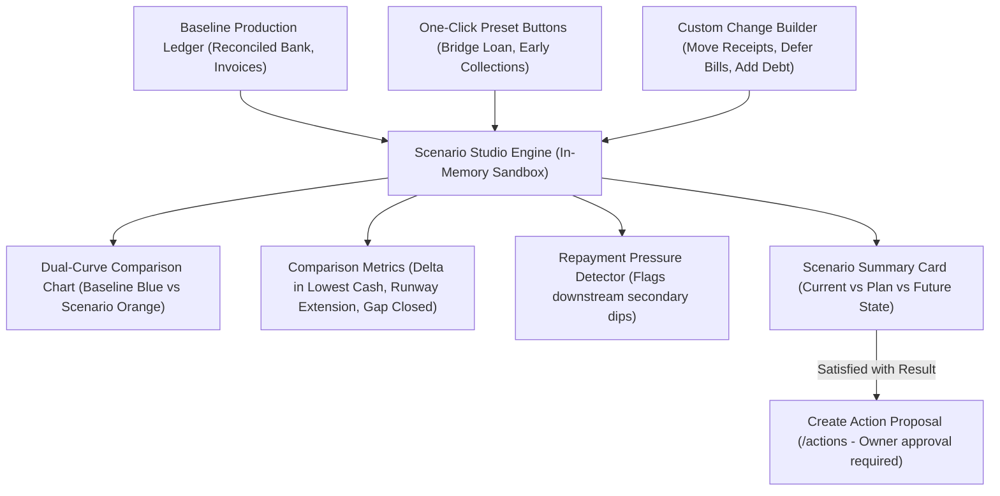
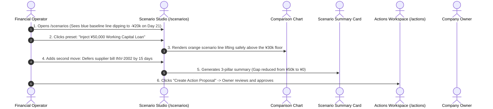

# HarborCFO What-If Scenarios: Comprehensive Executive & Technical Guide

This document provides a complete, presentation-ready overview of the **HarborCFO What-If Scenarios Feature** (`/scenarios`). It is designed for company owners, financial operators, employees, and pitch presentations to explain how financial simulations are modeled without altering production data, how baseline vs. scenario trajectories are compared, what each UI component does, and how different roles interact with the system.

---

## 1. Executive Summary & Core Purpose

In financial management, **guessing has catastrophic consequences**. If a business takes a loan too late, discounts receivables unnecessarily, or delays payments to the wrong supplier, the damage to creditworthiness and vendor relationships is irreversible.

HarborCFO’s **Scenario Studio** serves as a **risk-free financial sandbox**. It enables company owners and finance operators to test moves—such as negotiating invoice payment terms, drawing credit lines, or deferring supplier bills—and immediately observe the exact impact on their 91-day cash curve **without touching real database ledgers**.



### Key Value Propositions
- **Zero Production Risk**: Modifying invoice dates or simulating borrowings in Scenario Studio does not change real ledger balances until formally approved and executed.
- **Dual-Trajectory Visualization**: Displays the untouched **Baseline Reality** (Solid Blue) alongside the **Simulated Scenario** (Solid Orange) against the company's safety floor.
- **Automated Repayment Pressure Checking**: Prevents "robbing Peter to pay Paul" by warning operators if deferring payments or taking debt causes a secondary cash breach downstream.
- **One-Click Action Conversion**: Any winning scenario can be converted directly into a formal **Action Proposal** with a single click, ready for executive authorization.

---

## 2. Owner vs. Employee: Roles & Capabilities

The Scenario Studio is the primary collaborative playground for financial operators:

| Capability / Action | Company Owner | Company Employee | Operational & Planning Context |
| :--- | :---: | :---: | :--- |
| **Access Scenario Studio & Sandbox** | Full Access | Full Access | Both need the ability to model and test financial moves. |
| **Apply Quick Preset Scenarios** | Full Access | Full Access | One-click testing of common fixes (e.g. Early Collection, Bridge Loan). |
| **Build Multi-Step Custom Scenarios** | Full Access | Full Access | Combine multiple moves (e.g. factor 1 invoice + defer 1 supplier bill). |
| **Inspect Dual-Curve Comparison & Deltas** | Full Access | Full Access | Review quantitative impact on lowest cash and runway extension. |
| **Convert Scenario to Action Proposal** | Full Access | Full Access | Operators draft proposals; system pre-fills exact financial parameters. |
| **Approve & Execute the Final Action** | **Owner Only** | Read-Only | Only company owners hold legal authority to commit company capital. |

---

## 3. The 4 Scenario Building Operations

The Scenario Studio supports four granular, composable financial modifications:

```
┌─────────────────────────────────┐  ┌─────────────────────────────────┐
│        1. MOVE RECEIPT          │  │       2. DEFER PAYMENT          │
│ Accelerate customer collections │  │ Postpone vendor bills           │
│ • Shift expected settlement date│  │ • Shift payable due date        │
│ • Model early payment discount  │  │ • Protect short-term cash       │
└─────────────────────────────────┘  └─────────────────────────────────┘
┌─────────────────────────────────┐  ┌─────────────────────────────────┐
│        3. ADD FINANCING         │  │     4. ADD RECURRING COMMITMENT │
│ Model credit injection & debt   │  │ Model new operating expenses    │
│ • Inject loan principal on Day X│  │ • Add new payroll / office lease│
│ • Schedule monthly debt service │  │ • Test hiring affordability     │
└─────────────────────────────────┘  └─────────────────────────────────┘
```

1. **Move Receipt (`move_receipt`)**: Models what happens if an overdue or upcoming customer invoice arrives earlier (e.g., offering a 2% early settlement discount).
2. **Defer Payment (`defer_payment`)**: Models negotiating extended payment terms with a supplier, moving the cash outflow 15 to 30 days downstream.
3. **Add Financing (`add_financing`)**: Simulates a commercial loan, revolving line draw, or invoice factoring advance, including origination fees and amortization schedules.
4. **Add Recurring Commitment (`add_recurring`)**: Tests business expansion (e.g., hiring a new team member or leasing additional warehouse space) to ensure future cash flow can sustain the added fixed overhead.

---

## 4. Detailed Component Breakdown

```
ScenariosPage (/scenarios)
├── PageHeader & PageIntro (Plain language orientation, tips, dismissible state)
└── ScenarioStudio (Main sandbox workspace)
    ├── PresetButtons (One-click common scenarios)
    ├── ChangeBuilder (Accordion form for moving receipts, deferring payments, adding loans)
    ├── ChangeList (Active changes badge list with remove controls)
    ├── ComparisonChart (Dual-line Recharts chart: Baseline vs Scenario)
    ├── ComparisonMetrics (Delta tiles: Lowest Cash, Runway, Gap to Floor)
    ├── RepaymentWarning (Secondary cash crunch detector)
    ├── ScenarioSummaryCard (Three-pillar summary: Current vs Plan vs Result)
    └── StaleBanner (Notifies if underlying production data has changed)
```

---

### 4.1 Page Header & Friendly Guidance (`PageIntro`)
- **File**: `apps/web/src/app/(app)/scenarios/page.tsx` & `apps/web/src/components/layout/page-intro.tsx`
- **What it does**: Explains the simulation sandbox in welcoming, plain terms.
- **Key Elements**:
  - **Storage Key**: `harbor_intro_scenarios` (persisted in browser `localStorage`).
  - **Icon**: `GitBranch` (`git-branch`).
  - **Plain-Language Title & Description**:
    - *"What can I do here? — This is your financial sandbox. You can test things like 'What if I take a short-term loan?' or 'What if my biggest customer pays early?' and instantly see how your cash flow would change."*
  - **Practical Tips**:
    1. *"Use the quick preset buttons to try common scenarios with one click."*
    2. *"The orange line shows your modified scenario vs. the blue baseline."*
    3. *"Nothing you do here affects your real data — it's all simulation."*

---

### 4.2 One-Click Preset Buttons (`PresetButtons`)
- **File**: `apps/web/src/features/scenarios/components/preset-buttons.tsx`
- **What it does**: Provides pre-configured, realistic SME financial adjustments that can be applied with a single click.
- **Included Presets**:
  - **"Accelerate Top Customer AR"**: Moves largest outstanding receivable forward by 14 days.
  - **"Defer Major Supplier AP"**: Postpones largest supplier bill by 21 days.
  - **"Inject ¥50,000 Working Capital Loan"**: Simulates a 6-month term loan matching the exact liquidity gap.
  - **"Reset to Baseline"**: Instantly removes all applied modifications.

---

### 4.3 Custom Change Builder (`ChangeBuilder`)
- **File**: `apps/web/src/features/scenarios/components/change-builder.tsx`
- **What it does**: A structured accordion builder allowing operators to construct complex, multi-variable financial strategies.
- **Sub-Forms**:
  - `MoveReceiptForm`: Selects an existing unpaid invoice, picks a new expected date, and applies optional discount adjustments.
  - `DeferPaymentForm`: Selects a pending supplier payable and shifts the due date.
  - `AddFinancingForm`: Inputs loan amount, interest rate, term, and disbursement date.
  - `AddRecurringForm`: Inputs commitment label, amount, frequency, and start date.

---

### 4.4 Dual-Curve Comparison Chart (`ComparisonChart`)
- **File**: `apps/web/src/features/scenarios/components/comparison-chart.tsx`
- **What it does**: Visually contrasts the unadjusted baseline with the simulated future.
- **Visual Lines**:
  - **Solid Blue Line**: **Baseline Reality** (current projection, dipping below floor).
  - **Solid Orange Line**: **Scenario Trajectory** (projected cash path after applying changes).
  - **Dashed Amber Line**: **Policy Floor** (safety reserve threshold).
  - **Dashed Red Line**: **Zero Cash Boundary** (insolvency line).
- **Interactivity**: Hovering over any point displays a dual-tooltip comparing baseline cash vs. simulated cash on that exact day.

---

### 4.5 Comparison Metrics Grid (`ComparisonMetrics`)
- **File**: `apps/web/src/features/scenarios/components/comparison-metrics.tsx`
- **What it does**: Quantifies the exact financial delta achieved by the scenario.
- **Key Metric Tiles**:
  1. **Lowest Projected Cash**:
     - *Baseline*: `-¥20,000.00` $\to$ *Scenario*: `+¥30,000.00`
     - *Delta*: **+¥50,000.00 improvement** (styled in green).
  2. **Runway Duration**:
     - *Baseline*: `21 Days to Breach` $\to$ *Scenario*: `91+ Days Fully Protected`.
  3. **Liquidity Gap to Floor**:
     - *Baseline*: `¥50,000.00` $\to$ *Scenario*: `¥0.00` (**100% Deficit Resolved**).

---

### 4.6 Three-Pillar Scenario Summary Card (`ScenarioSummaryCard`)
- **File**: `apps/web/src/features/scenarios/components/scenario-summary-card.tsx`
- **What it does**: Renders an executive briefing paragraph explaining the simulation.
- **The Three Pillars**:
  1. **Current State**: Articulates current Day-21 breach and capital shortage.
  2. **Scenario Plan**: Lists the specific moves simulated (e.g. *"Accelerated INV-2001 by 14 days and drew ¥50,000 bridge facility"*).
  3. **Resulting Company State**: Confirms that cash remains safely above the policy floor throughout the entire 91-day horizon.
- **Primary CTA**: **"Create Action Proposal"** (`/actions`) button to formalize the strategy.

---

## 5. End-to-End Walkthrough Scenario (Presentation Story)

When presenting the Scenarios feature, use this interactive simulation narrative:



1. **Assessing Baseline Reality**:
   - The operator opens **What-If Scenarios** (`/scenarios`).
   - The chart displays the solid blue line plunging into the red danger zone on Day 21.
2. **Applying a Sandbox Preset**:
   - The operator clicks the preset button: **"Inject ¥50,000 Working Capital Loan"**.
   - The orange line instantly renders on the chart, maintaining cash well above the zero line.
3. **Fine-Tuning the Strategy**:
   - To reduce borrowing costs, the operator opens `ChangeBuilder` and adds: *"Move Customer Receipt (INV-2001) 10 days earlier"*.
   - The operator reduces the loan request from $¥50,000$ to $¥25,000$.
4. **Verifying Downstream Solvency**:
   - The operator checks the **Repayment Pressure** component, which confirms that the loan installments do not create any secondary breaches in Month 2 or Month 3.
5. **Formalizing the Solution**:
   - The operator reads the **Scenario Summary Card**, which summarizes the combined strategy.
   - The operator clicks **"Create Action Proposal"**, pushing the pre-configured parameters into `/actions` for the company owner to legally authorize.

---

## 6. Quick Reference for Pitch Presentations

If you have 60 seconds to explain the Scenarios feature in a pitch:

> *"In business, financial mistakes are permanent. If an owner signs an expensive loan or delays vendor payments without seeing the big picture, the fallout can destroy the company.*
> 
> *HarborCFO’s Scenario Studio is a flight simulator for business finances. In this sandbox, an operator can test multiple moves simultaneously—like negotiating customer payment terms, postponing supplier bills, or injecting credit—and see the exact impact on their cash curve in real time.*
> 
> *Our dual-curve chart shows the baseline reality in blue and the simulated future in orange. The system automatically warns operators if a quick fix today creates an even worse repayment crunch tomorrow. When the owner is satisfied, they can convert the simulation into an approved financial proposal with one click. It replaces guesswork with mathematical certainty."*
