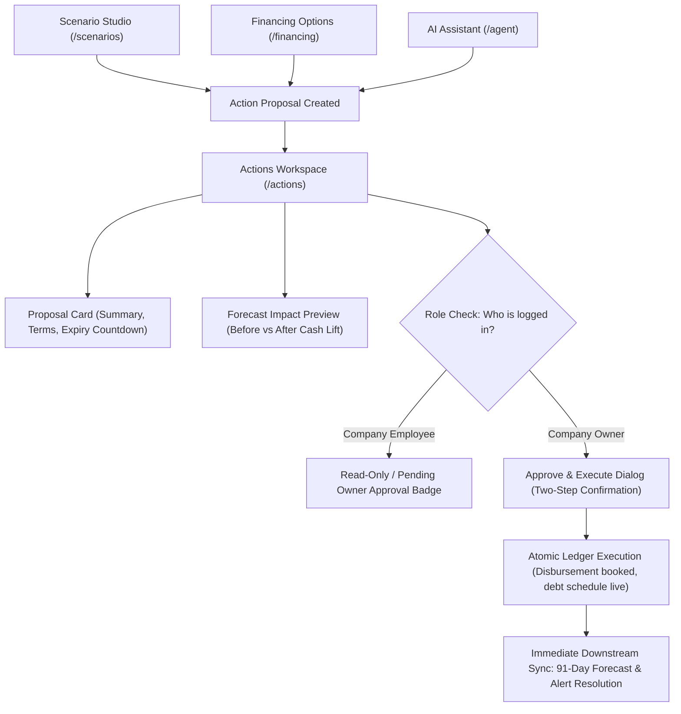
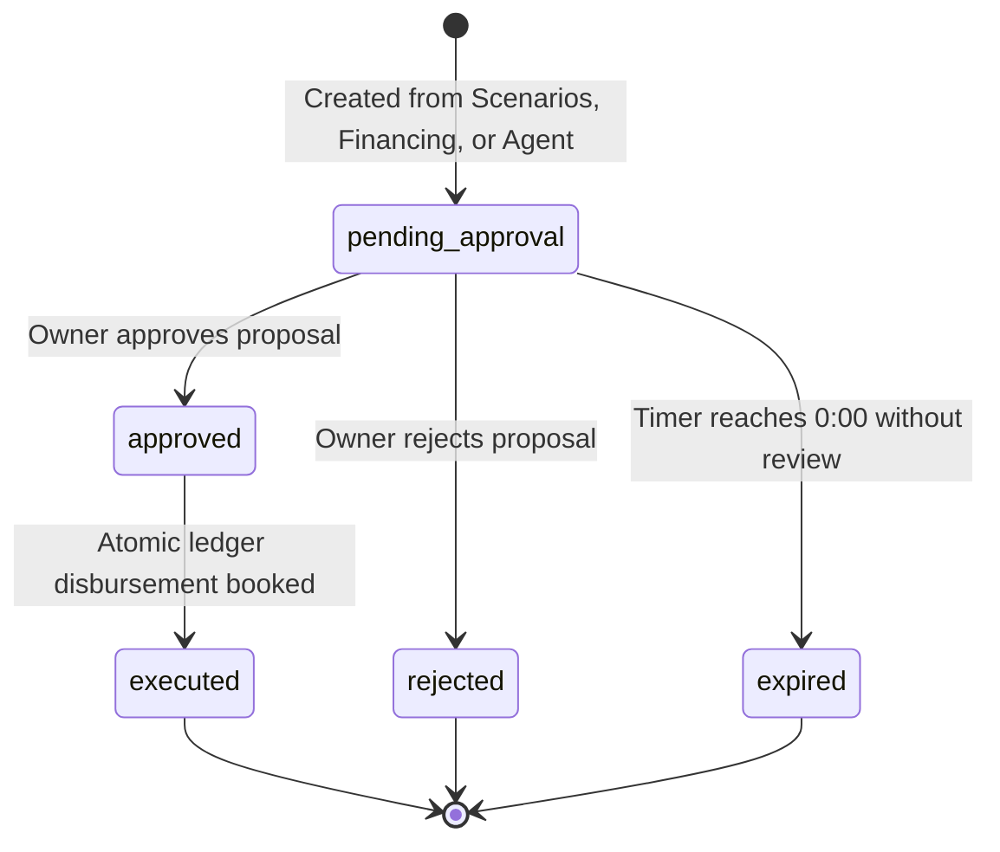

# HarborCFO Review & Approve Actions: Comprehensive Executive & Technical Guide

This document provides a complete, presentation-ready overview of the **HarborCFO Review & Approve Actions Feature** (`/actions`). It is designed for company owners, financial operators, employees, and pitch presentations to explain how financial proposals are governed, how fiduciary authorization is enforced between owners and employees, what each UI component does, and how execution impacts the live company ledger.

---

## 1. Executive Summary & Core Purpose

In corporate finance, **automation without governance is dangerous**. While AI agents and financial models can simulate scenarios and match loans, no autonomous system should ever be permitted to execute debt contracts, draw credit lines, or liquidate assets without human authorization.

HarborCFO enforces a strict **"Human-in-the-Loop" Fiduciary Boundary**. Employees and AI assistants can diagnose problems, compare facilities, and draft proposals, but **only the verified Company Owner** possesses legal signing authority to approve and execute capital actions.



### Key Value Propositions
- **Fiduciary Segregation of Duties**: Enforces SOX-grade internal controls. Non-owner staff can draft proposals, but cannot commit company liability.
- **Time-Bound Proposals (Expiry Countdown)**: Financial quotes expire (e.g. within 24 to 48 hours). Real-time countdown timers prevent executing stale loan rates or expired factoring terms.
- **Pre-Execution Forecast Impact**: Every proposal shows a side-by-side visual comparison of the cash runway *before* execution versus *after* execution.
- **Immutable Audit Trail**: Every approved, rejected, or executed proposal generates a tamper-proof audit event signed with the approver’s user ID and timestamp.

---

## 2. Owner vs. Employee: Roles & Capabilities

The Actions page is where governance and legal authority are enforced:

| Capability / Action | Company Owner | Company Employee | Governance & Legal Context |
| :--- | :---: | :---: | :--- |
| **View All Financial Proposals** | Full Access | Full Access | Full transparency into pending, approved, and executed actions. |
| **Inspect Financial Terms & Impact** | Full Access | Full Access | Operators review interest rates, repayment dates, and fees. |
| **Track Real-Time Expiry Countdown** | Full Access | Full Access | Both track how much time remains before quotes expire. |
| **Draft Proposals from Scenarios/Financing** | Full Access | Full Access | Employees prepare the operational work for owner sign-off. |
| **Approve Financial Proposals** | **Owner Only** | Restricted / Hidden | Only the business owner has fiduciary signing authority. |
| **Execute Capital Drawdowns** | **Owner Only** | Restricted / Hidden | Legally binding company debt requires owner authorization. |
| **Reject Unwanted Proposals** | **Owner Only** | Restricted / Hidden | Owners decide whether to dismiss a proposed financial move. |

---

## 3. Proposal Lifecycle States

Every financial action transitions through a deterministic state machine:



1. **`pending_approval`**: Proposal is drafted, terms are locked, and the countdown timer is ticking.
2. **`approved`**: Owner has authorized the action and initiated execution.
3. **`executed`**: Capital has been disbursed into the company bank account, debt amortization is active in the ledger, and the forecast has updated.
4. **`rejected`**: Owner declined the proposal; terms are archived for audit compliance.
5. **`expired`**: The review window lapsed; the proposal is invalidated to prevent executing stale market quotes.

---

## 4. Detailed Component Breakdown

```
ActionsPage (/actions)
├── PageHeader & PageIntro (Plain language orientation, tips, dismissible state)
└── ActionsWorkspace (Main governance orchestrator)
    ├── Filter Tabs (Pending Review, Executed History, Expired / Rejected)
    ├── ProposalList
    │   └── ProposalCard
    │       ├── ProposalHeader (Title, target amount, facility kind, provider)
    │       ├── ProposalStatusBadge (pending_approval, approved, executed, etc.)
    │       ├── ExpiryCountdown (Live countdown timer)
    │       ├── ProposalSummary (Executive narrative explaining the action)
    │       ├── ForecastImpact (Before vs After cash runway lift)
    │       └── ActionButtons (Approve & Execute, Reject / Pending Owner Approval)
    ├── ApprovalDialog (Two-step confirmation modal with legal terms)
    └── ExecutionResult (Post-execution confirmation banner & deep-links)
```

---

### 4.1 Page Header & Friendly Guidance (`PageIntro`)
- **File**: `apps/web/src/app/(app)/actions/page.tsx` & `apps/web/src/components/layout/page-intro.tsx`
- **What it does**: Explains why approvals exist and reinforces security.
- **Key Elements**:
  - **Storage Key**: `harbor_intro_actions` (persisted in browser `localStorage`).
  - **Icon**: `ShieldCheck` (`shield-check`).
  - **Plain-Language Title & Description**:
    - *"Why do I need to approve things? — For your safety, no financial action (like taking a loan) happens automatically. The system creates a proposal, shows you exactly what will happen, and waits for your explicit approval."*
  - **Practical Tips**:
    1. *"Only the business Owner can approve proposals."*
    2. *"Each proposal shows the exact impact on your cash flow before you approve."*
    3. *"Proposals expire if not reviewed — check the countdown timer."*

---

### 4.2 Proposal Card (`ProposalCard`)
- **File**: `apps/web/src/features/actions/components/proposal-card.tsx`
- **What it does**: The primary container displaying all details of an individual financial proposal.
- **Card Structure**:
  - **Header Bar**:
    - **Title**: e.g., *"Draw Working Capital Bridge Loan — Commercial Bank Partner"*.
    - **Status Badge (`ProposalStatusBadge`)**: Color-coded pill (`pending_approval`, `executed`, `rejected`, `expired`).
    - **Expiry Countdown (`ExpiryCountdown`)**: Live pulsing timer showing hours/minutes remaining before quote expiry.
  - **Summary Narrative**:
    - A plain-language paragraph explaining why the action was created (e.g. *"This proposal injects ¥50,000.00 of bridge financing on Day 18 to bridge the liquidity gap caused by customer concentration in Apex Distribution Ltd."*).
  - **Key Terms Grid**:
    - `Requested Capital`: e.g. `¥50,000.00`.
    - `Interest Rate / Fee`: e.g. `6.50% APR (Total interest: ¥1,250.00)`.
    - `Tenor`: e.g. `6 Months amortized`.
    - `Initiator`: Shows whether created by an Employee, Owner, or the AI Assistant.

---

### 4.3 Forecast Impact Preview (`ForecastImpact`)
- **File**: `apps/web/src/features/actions/components/forecast-impact.tsx`
- **What it does**: Provides a visual preview of what will happen to the company's cash flow if this proposal is executed.
- **Visual Presentation**:
  - **Before Execution**: Lowest cash is `-¥20,000.00` on Day 21 (red danger state).
  - **After Execution**: Lowest cash lifts to `+¥30,000.00` (green safe state).
  - **Runway Impact**: Extends runway from `21 Days` to `91+ Days Fully Protected`.

---

### 4.4 Two-Step Approval Modal (`ApprovalDialog`)
- **File**: `apps/web/src/features/actions/components/approval-dialog.tsx`
- **What it does**: Prevents accidental clicks by requiring explicit executive confirmation.
- **Key Elements**:
  - Prompts the owner: *"Confirm Execution of ¥50,000.00 Working Capital Facility"*.
  - Discloses terms: *"By clicking Approve & Execute, you legally authorize this borrowing facility. Funds will disburse immediately into your operating bank account, and repayment schedules will activate in the company ledger."*
  - Action Buttons: `Cancel` (dismiss) and `Yes, Approve & Execute` (submits transaction with loading spinner).

---

### 4.5 Execution Result Banner (`ExecutionResult`)
- **File**: `apps/web/src/features/actions/components/execution-result.tsx`
- **What it does**: Displays post-execution confirmation once the ledger write succeeds.
- **Elements**:
  - Green banner with `CheckCircle2`: *"Proposal Executed Successfully — ¥50,000.00 disbursed to operating ledger."*
  - Fast-action links to `/dashboard` and `/forecast` to inspect the updated live runway.

---

## 5. End-to-End Walkthrough Scenario (Presentation Story)

When demonstrating governance on the Actions page, use this fiduciary sign-off narrative:

```mermaid
sequenceDiagram
    autonumber
    actor Employee as Financial Operator
    actor Owner as Company Owner
    actor ActionsUI as Actions Workspace (/actions)
    actor Dialog as Approval Dialog
    actor Ledger as Double-Entry Ledger
    actor Forecast as 91-Day Forecast

    Employee->>ActionsUI: 1. Drafts proposal from Scenarios: "Draw ¥50k Bridge Loan"
    Employee->>ActionsUI: 2. Views proposal card: Sees "Pending Owner Approval" (No execute button)
    Owner->>ActionsUI: 3. Logs in as Owner; navigates to /actions
    Owner->>ActionsUI: 4. Reviews Proposal Summary, 6.5% APR terms, and Forecast Impact
    Owner->>Dialog: 5. Clicks "Approve & Execute"; confirms terms in two-step modal
    Dialog->>Ledger: 6. Books ¥50k cash inflow & sets up 6-month repayment schedule
    Ledger-->>Forecast: 7. Recalculates cash trajectory -> Day-21 breach eliminated!
```

1. **Operator Prepares the Move**:
   - An employee creates a proposal in `/scenarios` to solve the upcoming cash gap.
   - The employee opens `/actions`. Because their role is `employee`, the card displays: *"Pending Owner Approval"*. The execute button is disabled, protecting company security.
2. **Owner Receives & Reviews**:
   - The company owner logs in. On `/actions`, they see the active proposal with a countdown timer showing 23 hours remaining.
   - The owner reads the **Proposal Summary** and verifies that total interest is only $¥1,250.
3. **Checking Forecast Impact**:
   - The owner inspects the **Forecast Impact** component, which demonstrates that executing this proposal lifts trough cash from $-¥20,000$ to $+¥30,000$.
4. **Fiduciary Execution**:
   - The owner clicks **"Approve & Execute"**.
   - The **Approval Dialog** opens, requiring final confirmation. The owner clicks **"Yes, Approve & Execute"**.
5. **Immediate Ledger Synchronization**:
   - The system executes the atomic ledger transaction:
     - Disburses $¥50,000$ into the operating bank account.
     - Schedules monthly repayments over the next 6 months.
   - The owner clicks **"View Updated Dashboard"**, where the cash gap is now completely resolved.

---

## 6. Quick Reference for Pitch Presentations

If you have 60 seconds to explain the Actions page in a pitch:

> *"AI and automation in finance are useless if they cannot be trusted. If an AI or junior accountant could unilaterally borrow money or pledge company receivables, no business owner would ever use the platform.*
> 
> *HarborCFO solves this with a strict fiduciary boundary on our Actions page. Employees and AI assistants can diagnose shortfalls, model scenarios, and prepare term sheets, but only the verified Company Owner can legally approve and execute financial commitments.*
> 
> *Every proposal includes a live countdown timer to prevent executing stale rates, alongside an exact before-and-after forecast impact preview. Once the owner approves, funds are disbursed atomically to the company ledger, creating a tamper-proof audit record. It provides the speed of modern fintech with the governance of an enterprise boardroom."*
