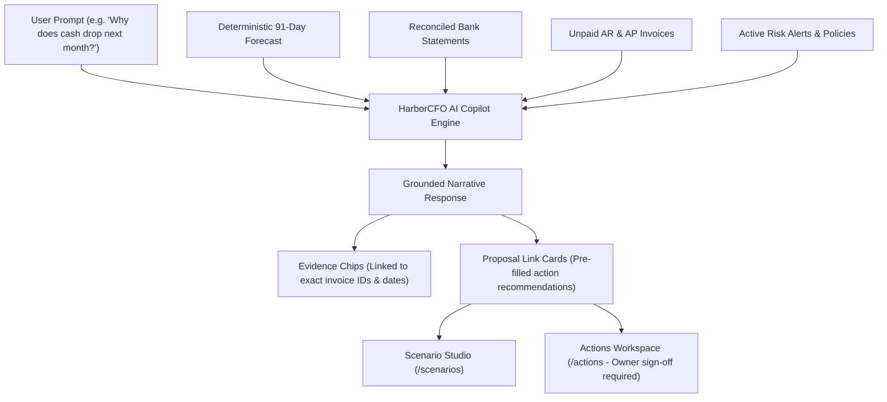

# HarborCFO AI Finance Assistant: Comprehensive Executive & Technical Guide

This document provides a complete, presentation-ready overview of the **HarborCFO AI Finance Assistant Feature** (`/agent`). It is designed for company owners, financial operators, employees, and pitch presentations to explain how conversational AI is grounded in deterministic accounting ledgers, how evidence chips eliminate hallucinations, what each UI component does, and how different roles interact with the system.

---

## 1. Executive Summary & Core Purpose

Most conversational AI assistants are dangerous in corporate finance because they suffer from **hallucination**—inventing believable numbers, fabricating dates, and offering generic advice without understanding real company balance sheets.

HarborCFO’s **AI Finance Assistant** is built on a **Strictly Grounded Retrieval & Evidence Architecture**. The agent does not calculate cash balances on its own; instead, it queries HarborCFO’s deterministic cash engine, ledger tables, and active risk alerts. Every claim, number, and recommendation is backed by clickable **Evidence Chips** that link directly to verified ledger entries.



### Key Value Propositions
- **Zero Hallucination with Evidence Chips**: Every balance, date, and invoice mentioned in chat is accompanied by a verifiable evidence chip. Users can click any chip to see the underlying bank record.
- **Natural Language Accessibility**: Non-financial founders can ask questions in plain English (*"Can we afford to hire two engineers next month?"*) and receive mathematically grounded answers.
- **Actionable Recommendations**: The assistant does not stop at answering questions; it generates **Proposal Link Cards** that let operators convert recommendations into actionable proposals in one click.
- **Strict Fiduciary Sandboxing**: The assistant has **zero write-authority**. It can analyze, explain, and draft proposals, but can never execute financial transactions or pledge company capital.

---

## 2. Owner vs. Employee: Roles & Capabilities

The AI Finance Assistant empowers both operators and executives:

| Capability / Action | Company Owner | Company Employee | Operational & Strategic Context |
| :--- | :---: | :---: | :--- |
| **Chat with AI Finance Assistant** | Full Access | Full Access | Both ask questions, explore trends, and diagnose issues. |
| **Use Quick-Prompt Suggestions** | Full Access | Full Access | Pre-built queries for quick situational awareness. |
| **Inspect Grounded Evidence Chips** | Full Access | Full Access | Both verify source invoices and bank records cited by the AI. |
| **Toggle Summary vs Technical Style** | Full Access | Full Access | Owners prefer executive summaries; accountants prefer technical depth. |
| **Convert Advice to Action Proposal** | Full Access | Full Access | Operators generate proposals based on AI recommendations. |
| **Approve AI-Generated Proposals** | **Owner Only** | Read-Only | Fiduciary control remains strictly with the company owner. |

---

## 3. Grounded Architecture: How It Works

The AI Assistant operates under a strict three-tier prompt and grounding protocol:

```
┌─────────────────────────────────┐  ┌─────────────────────────────────┐  ┌─────────────────────────────────┐
│     1. CONTEXT RETRIEVAL        │  │     2. DETERMINISTIC CONTEXT    │  │     3. EVIDENCE CITATION        │
│ User prompts are matched against│  │ Engine injects verified forecast│  │ Output MUST cite source data   │
│ platform APIs                   │  │ points, invoices, and alerts    │  │ as clickable evidence chips     │
└─────────────────────────────────┘  └─────────────────────────────────┘  └─────────────────────────────────┘
```

1. **Deterministic Context Injection**: Before the model generates a single token, HarborCFO injects verified structured data: current cash balance ($¥80,000$), lowest projected cash ($-¥20,000$), breach date (Day 21), top customer concentration ($66.7\%$), and open receivables.
2. **Boundary Enforcement**: The model's system prompt forbids estimating balances or inventing financing rates. If a user asks a speculative question (*"What will sales be in 2028?"*), the assistant politely refuses, explaining that it only projects known contractual commitments.
3. **Structured Evidence Generation**: The model emits structured JSON tags referencing verified entities (`<evidence type="invoice" id="INV-2001" />`). The frontend compiles these into interactive UI chips.

---

## 4. Detailed Component Breakdown

```
AgentPage (/agent)
├── PageHeader & PageIntro (Plain language orientation, tips, dismissible state)
└── AgentWorkspace (Main split-view workspace)
    ├── PastRunsSidebar (Investigation history and previous chat threads)
    ├── ChatStream
    │   ├── StyleToggle (Executive Summary vs Detailed Technical mode)
    │   ├── MessageList
    │   │   ├── UserMessage (User prompt bubble)
    │   │   └── AssistantMessage
    │   │       ├── Markdown Content (Formatted explanations, bold metrics)
    │   │       ├── EvidenceChips (Clickable badges linking to invoices/dates)
    │   │       └── ProposalLinkCard (Embedded action card with pre-filled inputs)
    │   └── ChatInput (Textarea, keyboard submit shortcut, prompt suggestions)
    └── SuggestedPrompts (Quick-click common financial queries)
```

---

### 4.1 Page Header & Friendly Orientation (`PageIntro`)
- **File**: `apps/web/src/app/(app)/agent/page.tsx` & `apps/web/src/components/layout/page-intro.tsx`
- **What it does**: Introduces the AI assistant warmly to non-technical users.
- **Key Elements**:
  - **Storage Key**: `harbor_intro_agent` (persisted in browser `localStorage`).
  - **Icon**: `Bot` (`bot`).
  - **Plain-Language Title & Description**:
    - *"Meet your finance assistant — Ask me anything about your business finances in plain English! I can explain your cash forecast, suggest ways to improve cash flow, help you understand alerts, and guide you through financial decisions."*
  - **Practical Tips**:
    1. *"Try asking: 'Why is my cash running low next month?'"*
    2. *"Or: 'What are my options to cover the shortfall?'"*
    3. *"I can only suggest actions — you always make the final decision."*

---

### 4.2 Suggested Prompts (`SuggestedPrompts`)
- **File**: `apps/web/src/features/agent/components/suggested-prompts.tsx`
- **What it does**: Provides instant starting points for users who are unsure what to ask.
- **Sample Prompts**:
  - *"Why is cash projected to dip below the floor on November 10?"*
  - *"What are our lowest-cost borrowing options to cover the ¥50,000 gap?"*
  - *"Which customers represent the greatest concentration risk?"*
  - *"What happens if our largest client delays payment by two weeks?"*

---

### 4.3 Grounded Assistant Message (`AssistantMessage` & `EvidenceChips`)
- **File**: `apps/web/src/features/agent/components/assistant-message.tsx` & `evidence-chips.tsx`
- **What it does**: Renders AI responses formatted in clean GitHub markdown, accompanied by mathematical citations.
- **Key Features**:
  - **Formatted Financial Explanations**: Uses bullet points, bold numbers, and plain-language definitions.
  - **Evidence Chips (`EvidenceChips`)**:
    - `Day-21 Breach`: Clicking jumps to `/forecast?date=2026-11-10`.
    - `INV-2001 (¥80,000)`: Clicking opens the invoice audit modal.
    - `Alert #1 (Concentration)`: Clicking jumps to `/alerts`.
  - **Style Toggle (`StyleToggle`)**: Allows switching between:
    - **Executive Summary**: 3 bullet points focused on executive decisions.
    - **Detailed Technical**: Full accounting breakdown with formulas and aging tables.

---

### 4.4 Actionable Proposal Link Card (`ProposalLinkCard`)
- **File**: `apps/web/src/features/agent/components/proposal-link-card.tsx`
- **What it does**: Bridges conversational AI to tangible financial execution.
- **Key Elements**:
  - Appears inside the assistant's message when a concrete action is recommended.
  - Displays: Action Title (*"Draw ¥50,000 Working Capital Facility"*), Provider (*Commercial Bank*), Term (*6 Months*), and Estimated Interest (*¥1,250*).
  - Primary CTA: **"Review Proposal in Actions"** button, taking the user directly to `/actions` with all parameters pre-populated.

---

### 4.5 Past Investigation Runs Sidebar (`PastRunsSidebar`)
- **File**: `apps/web/src/features/agent/components/past-runs-sidebar.tsx`
- **What it does**: Maintains a navigable history of past financial investigations.
- **Key Elements**:
  - Lists prior chat sessions (e.g., *"November Runway Audit"*, *"Apex Factoring Analysis"*).
  - Allows finance teams to revisit previous conclusions and share findings across the organization.

---

## 5. End-to-End Walkthrough Scenario (Presentation Story)

When demonstrating the AI Finance Assistant, use this conversational investigation narrative:

```mermaid
sequenceDiagram
    autonumber
    actor Founder as Non-Financial Founder
    actor Agent as AI Finance Copilot (/agent)
    actor Forecast as Cash Forecast Engine
    actor Proposal as Actions Workspace (/actions)
    actor Owner as Company Owner

    Founder->>Agent: 1. Asks: "Why is our cash running low next month?"
    Agent->>Forecast: 2. Queries 91-day engine & active risk alerts
    Forecast-->>Agent: 3. Returns Day-21 breach (-¥20k), INV-2001 timing, ¥12k rent commitment
    Agent->>Founder: 4. Replies in plain English with clickable Evidence Chips
    Founder->>Agent: 5. Asks: "What's our best option to fix this?"
    Agent->>Founder: 6. Recommends Working Capital Loan & renders Proposal Link Card
    Founder->>Proposal: 7. Clicks card to open proposal; Owner approves in one click
```

1. **Asking the Core Question**:
   - The founder opens `/agent` and clicks the prompt: *"Why is my cash running low next month?"*.
2. **Deterministic Analysis**:
   - The AI Assistant analyzes the 91-day model and replies in plain English:
     > *"Your cash is projected to drop to -¥20,000.00 on November 10 because a ¥12,000.00 rent payment and ¥18,000.00 supplier bill coincide, while your largest customer (Apex Distribution) has not yet settled their ¥80,000.00 invoice."*
3. **Verifying Evidence**:
   - The founder clicks the **`[INV-2001]`** evidence chip. The invoice modal opens, confirming that the bill is scheduled for November 25—fifteen days after the rent is due.
4. **Seeking Capital Recommendations**:
   - The founder types: *"What is the cheapest way to cover the ¥50,000 shortfall?"*.
   - The assistant evaluates matched facilities and replies:
     > *"A 6-month Working Capital Loan from Commercial Bank at 6.50% APR will cost only ¥1,250.00 in total interest, whereas invoice factoring would cost ¥1,600.00."*
5. **Converting Conversation to Action**:
   - The assistant renders an embedded **Proposal Link Card**.
   - The founder clicks **"Review Proposal in Actions"**. The Owner opens `/actions` and authorizes the loan.

---

## 6. Quick Reference for Pitch Presentations

If you have 60 seconds to explain the AI Agent feature in a pitch:

> *"Generative AI in finance has a fatal flaw: hallucination. An AI that makes up numbers or gives generic advice is a liability, not an asset.*
> 
> *HarborCFO’s AI Finance Assistant is strictly grounded in deterministic ledger data. When a founder asks why cash is dipping or how to fix a shortfall, our agent references actual bank balances, invoice due dates, and active alerts.*
> 
> *Every single figure is backed by an interactive Evidence Chip that links directly to the underlying invoice or ledger entry. When the assistant recommends a solution, it generates an actionable Proposal Card that pushes directly into our governance workflow for owner approval. It’s like having an expert CFO sitting next to you who explains your numbers in plain English and backs up every claim with mathematical proof."*
