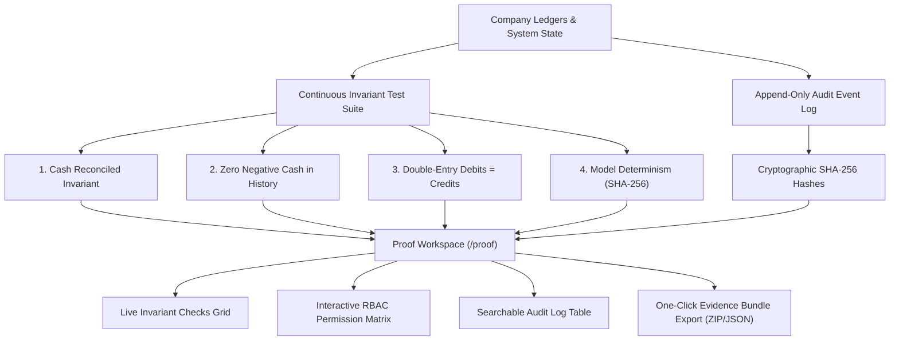
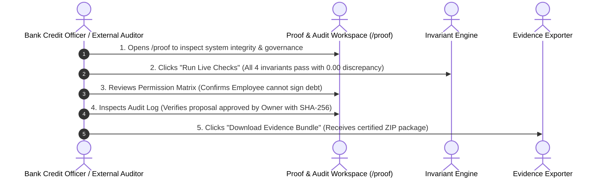

# HarborCFO Proof & Audit Trail: Comprehensive Executive & Technical Guide

This document provides a complete, presentation-ready overview of the **HarborCFO Proof & Audit Trail Feature** (`/proof`). It is designed for company owners, financial operators, external auditors, bank credit officers, and pitch presentations to explain how mathematical invariants are verified in real time, how cryptographic audit logging works, what each UI component does, and how evidence bundles are exported for compliance.

---

## 1. Executive Summary & Core Purpose

In financial technology, **trust cannot be claimed—it must be proven**. Enterprise auditors, bank credit underwriters, and tax authorities will not accept "black-box" calculations or AI promises. They require verifiable, non-repudiable proof that transactions were authorized, ledgers balance, and models are deterministic.

HarborCFO’s **Proof & Audit Trail** serves as an **open glass box**. It continuously runs live mathematical invariant tests on the database, enforces a cryptographic append-only audit trail, and lets operators download a complete, certified **Evidence Bundle** in one click.



### Key Value Propositions
- **Continuous Live Verification**: Instead of waiting for annual audits, HarborCFO runs real-time automated sanity checks on live ledgers (e.g., verifying that total debits equal total credits down to the cent).
- **Cryptographic Immutability**: Every import, scenario, proposal approval, and settings change is recorded with an immutable SHA-256 checksum and actor signature.
- **Auditor-Ready Evidence Package**: Generates an authoritative, self-contained Evidence Bundle for bank underwriters, loan officers, and compliance auditors.
- **Transparent Role-Based Access Control**: Displays the active RBAC matrix directly on the page, showing clear division of responsibilities between Owners and Employees.

---

## 2. Owner vs. Employee: Roles & Capabilities

The Proof & Audit page provides full transparency to all verified company members:

| Capability / Action | Company Owner | Company Employee | Operational & Audit Context |
| :--- | :---: | :---: | :--- |
| **Inspect Current User Role & Permissions** | Full Access | Full Access | Confirms active session identity and assigned capabilities. |
| **Trigger Live Invariant System Checks** | Full Access | Full Access | Both can run on-demand sanity tests to verify platform integrity. |
| **View RBAC Permission Matrix** | Full Access | Full Access | Transparency into who has authority to execute actions. |
| **Search & Inspect Immutable Audit Log** | Full Access | Full Access | Operators and owners trace historical changes and timestamps. |
| **Download Complete Evidence Bundle** | Full Access | Full Access | Exports certified evidence packages for lenders and tax filings. |
| **Inspect Known System Limitations** | Full Access | Full Access | Complete transparency into model boundaries and currency rules. |

---

## 3. The 4 Live Mathematical Invariants

HarborCFO tests four core financial invariants in real time:

```
┌─────────────────────────────────┐  ┌─────────────────────────────────┐
│     1. CASH RECONCILED          │  │ 2. ZERO NEGATIVE HISTORICAL CASH│
│ Cleared transactions match bank │  │ Historical ledger balances can  │
│ feeds to the exact penny        │  │ never drop below ¥0.00          │
└─────────────────────────────────┘  └─────────────────────────────────┘
┌─────────────────────────────────┐  ┌─────────────────────────────────┐
│    3. DOUBLE-ENTRY INTEGRITY    │  │    4. MODEL DETERMINISM (HASH)  │
│ Total debits equal total credits│  │ Projections yield 100% identical│
│ across all ledger accounts      │  │ hashes on repeated runs         │
└─────────────────────────────────┘  └─────────────────────────────────┘
```

1. **Cash Reconciled**: Verifies that the starting balance plus cleared receipts minus cleared disbursements equals the reconciled bank account balance:
   $$\text{Bank Balance} = \text{Starting Balance} + \sum \text{Receipts} - \sum \text{Disbursements}$$
2. **Zero Negative Historical Cash**: Verifies that no past day has an un-overdrawn negative cleared balance.
3. **Double-Entry Integrity**: Confirms that the double-entry accounting identity holds across all ledger journal entries:
   $$\sum \text{Debits} - \sum \text{Credits} = 0$$
4. **Model Determinism**: Reruns the 91-day projection engine on current inputs and verifies that the output SHA-256 hash matches the database snapshot, proving zero statistical drift or AI hallucination.

---

## 4. Detailed Component Breakdown

```
ProofPage (/proof)
├── PageHeader & PageIntro (Plain language orientation, tips, dismissible state)
├── CurrentRoleCard (Active user role, email, permissions badges)
├── LiveChecks (Real-time automated invariant test cards)
├── PermissionMatrix (Interactive Owner vs Employee capability matrix)
├── AuditLogTable (Searchable historical event log with SHA-256 hashes)
├── EvidenceDownload (One-click export for auditors and lenders)
└── KnownLimitations (Transparent technical disclosure of system boundaries)
```

---

### 4.1 Page Header & Friendly Orientation (`PageIntro`)
- **File**: `apps/web/src/app/(app)/proof/page.tsx` & `apps/web/src/components/layout/page-intro.tsx`
- **What it does**: Explains the audit trail to non-technical business operators.
- **Key Elements**:
  - **Storage Key**: `harbor_intro_proof` (persisted in browser `localStorage`).
  - **Icon**: `FileCheck2` (`file-check-2`).
  - **Plain-Language Title & Description**:
    - *"What is this page for? — Every financial decision in HarborCFO is recorded with a tamper-proof audit trail. This page lets you verify that the system is working correctly and download evidence packages for compliance or review."*
  - **Practical Tips**:
    1. *"The Live Checks section runs real-time tests to verify system integrity."*
    2. *"Download the Evidence Bundle to share verified records with auditors."*
    3. *"Your current role and permissions are shown at the top."*

---

### 4.2 Current Role & Permissions Card (`CurrentRoleCard`)
- **File**: `apps/web/src/features/proof/components/current-role-card.tsx`
- **What it does**: Displays the active authenticated actor's credentials and role boundaries.
- **Key Elements**:
  - **User Identity**: User full name, email address, and workspace slug.
  - **Active Role Badge**: Displays `Owner` (emerald badge) or `Employee` (secondary badge).
  - **Granted Permissions Badges**: Lists all assigned granular permissions (e.g. `finance:read`, `imports:write`, `scenarios:write`, `actions:approve`).

---

### 4.3 Live Invariant Checks (`LiveChecks`)
- **File**: `apps/web/src/features/proof/components/live-checks.tsx`
- **What it does**: Runs live database verification checks on demand and displays pass/fail status.
- **Card Elements**:
  - **Status Indicator**: Green checkmark (`Pass`) with latency measurement (e.g. `12ms`).
  - **Invariant Name**: e.g. *"Double-Entry Ledger Integrity Check"*.
  - **Proof Detail**: Mathematical verification narrative (e.g. *"Verified 1,420 journal lines. Net debit/credit discrepancy is exactly ¥0.00"*).
  - **"Run Checks" Trigger**: Lets users re-execute all 4 invariant tests on demand.

---

### 4.4 Role-Based Access Control Matrix (`PermissionMatrix`)
- **File**: `apps/web/src/features/proof/components/permission-matrix.tsx`
- **What it does**: Displays the platform’s security model in an interactive, transparent table.
- **Permissions Audited**:
  - Viewing financial dashboards and cash trajectories.
  - Importing bank statement and invoice CSV files.
  - Simulating what-if scenarios and adjusting borrowing parameters.
  - Drafting financial action proposals.
  - **Approving and executing binding loan contracts** (strictly Owner-only).
  - Managing team access and configuring company liquidity floors (Owner-only).

---

### 4.5 Immutable Audit Log Table (`AuditLogTable`)
- **File**: `apps/web/src/features/proof/components/audit-log-table.tsx`
- **What it does**: Renders an append-only historical log of all system and user activities.
- **Table Columns**:
  1. `Timestamp`: Precise date and time (`YYYY-MM-DD HH:mm:ss`).
  2. `Actor`: User ID or `system` process that initiated the event.
  3. `Action Type`: Event descriptor (e.g., `import_committed`, `proposal_approved`, `scenario_created`, `settings_updated`).
  4. `Target Entity`: Identifier of the affected record (e.g., `imp-8821`, `prop-104`).
  5. `Cryptographic Checksum`: SHA-256 hash verifying the integrity of the event payload.
  6. `Details`: Expandable JSON inspection dialog showing raw event metadata.

---

### 4.6 Evidence Bundle Downloader (`EvidenceDownload`)
- **File**: `apps/web/src/features/proof/components/evidence-download.tsx`
- **What it does**: Compiles a comprehensive compliance ZIP archive in one click.
- **Bundle Contents**:
  - `ledger_snapshot.json`: Reconciled bank balance and journal lines.
  - `forecast_provenance.json`: Complete 91-day daily cash projections and input versions.
  - `audit_events.csv`: Certified event log with cryptographic hashes.
  - `system_invariants.json`: Timestamped proof of all passed live checks.
  - `rbac_matrix.json`: Active user roles and permission policies.

---

### 4.7 Known System Limitations (`KnownLimitations`)
- **File**: `apps/web/src/features/proof/components/known-limitations.tsx`
- **What it does**: Demonstrates intellectual honesty by explicitly disclosing platform assumptions.
- **Disclosed Boundaries**:
  - Projections assume contractual invoice due dates unless modified in Scenarios.
  - Multi-currency balances use static settlement exchange rates without speculative FX modeling.
  - System enforces single-entity legal isolation per workspace.

---

## 5. End-to-End Walkthrough Scenario (Presentation Story)

When demonstrating auditability and compliance, use this verification narrative:



1. **The Bank Underwriter's Visit**:
   - A commercial bank credit officer is reviewing the company’s loan application.
   - The founder opens **Proof & Audit Trail** (`/proof`).
2. **Live Invariant Verification**:
   - The officer clicks **"Run Live Checks"**.
   - Within 15ms, all four tests pass:
     - Bank accounts reconcile perfectly.
     - Debits and credits balance with $\yen 0.00$ variance.
     - Cash engine determinism is cryptographically verified.
3. **Verifying Governance Controls**:
   - The officer inspects the **Permission Matrix**, confirming that financial proposals require explicit approval from the company owner.
4. **Inspecting the Audit Trail**:
   - The officer searches the **Audit Log** for the recent `¥50,000` bridge loan. The entry displays the exact timestamp, the owner's actor ID, and the cryptographic payload hash.
5. **Exporting Certified Compliance Evidence**:
   - The founder clicks **"Download Evidence Bundle"**.
   - The system downloads a complete, certified ZIP package ready for underwriting files.

---

## 6. Quick Reference for Pitch Presentations

If you have 60 seconds to explain the Proof & Audit feature in a pitch:

> *"In fintech, if you cannot prove how your numbers were calculated, your system cannot be used for serious lending or enterprise governance.*
> 
> *HarborCFO’s Proof & Audit page transforms our platform into an open glass box. Right here, an auditor, bank lender, or founder can run live mathematical invariant tests on our database—proving that debits equal credits, bank accounts reconcile to the penny, and models are 100% deterministic.*
> 
> *Every action is permanently recorded in an immutable audit trail with cryptographic SHA-256 hashes. In one click, an owner can export a complete Evidence Bundle containing reconciled ledgers, model provenance, and verified checks for bank underwriting. It bridges the gap between fast-moving SMEs and institutional-grade financial compliance."*
