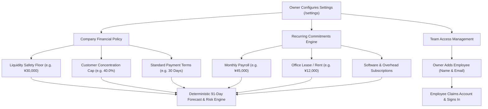

# HarborCFO Settings & Team: Comprehensive Executive & Technical Guide

This document provides a complete, presentation-ready overview of the **HarborCFO Settings & Team Feature** (`/settings`). It is designed for company owners, financial operators, employees, and pitch presentations to explain how company financial policies are established, how recurring commitments feed into the 91-day forecast, what each UI component does, and how team access is governed.

---

## 1. Executive Summary & Core Purpose

Every business operates under different financial rules and risk tolerances. A high-growth e-commerce brand might require an emergency buffer of $¥100,000$, while a lean consultancy needs only $¥20,000$. Similarly, a company's largest cash drains are often fixed operational commitments—like monthly payroll, office leases, and software licenses—that do not appear on standard invoices.

HarborCFO’s **Settings & Team Workspace** is the **operational control room** of the business. It allows company owners to configure core financial rules (such as liquidity floors and customer concentration caps), register recurring commitments that automatically project into the 91-day forecast, and securely manage team access.



### Key Value Propositions
- **Dynamic Downstream Synchronization**: Changing the Liquidity Safety Floor from $¥30,000$ to $¥40,000$ immediately shifts the amber threshold line across all charts and updates breach alerts in real time.
- **Automated Commitment Projection**: Operators enter fixed recurring expenses (payroll, rent, leases) once, and HarborCFO automatically projects them forward across all 91 days of the cash forecast.
- **Invited-Only Employee Onboarding**: Protects workspace isolation by requiring company owners to add an employee's email before that employee can register or sign in.
- **Clean Fiduciary Delegation**: Employees can view settings and commitments to understand company policies, but only the Owner can modify safety floors or add new team members.

---

## 2. Owner vs. Employee: Roles & Capabilities

The Settings page enforces strict administrative boundaries:

| Capability / Action | Company Owner | Company Employee | Administrative Context |
| :--- | :---: | :---: | :--- |
| **Inspect Company Profile & Rules** | Full Access | Full Access | Employees need to know company payment terms and policies. |
| **View Recurring Commitments** | Full Access | Full Access | Operators review fixed payroll and lease schedules. |
| **View Team Member Roster** | Full Access | Full Access | Transparency regarding who has access to the workspace. |
| **Modify Liquidity Floor & Policies** | **Owner Only** | Read-Only | Changing cash reserve requirements is an executive decision. |
| **Create or Delete Commitments** | **Owner Only** | Read-Only | Adding contractual liabilities requires owner authorization. |
| **Add / Invite Team Members** | **Owner Only** | Read-Only | Only owners can grant access to company financial records. |

---

## 3. Detailed Component Breakdown

```
SettingsPage (/settings)
├── PageHeader & PageIntro (Plain language orientation, tips, dismissible state)
└── SettingsTabs (4 Tabbed Configuration Panels)
    ├── Tab 1: Company Profile & Rules (CompanySettingsForm & BusinessProfileForm)
    │   ├── Legal Name, Trade Name, Slug
    │   ├── Default Currency (CNY)
    │   ├── Liquidity Safety Floor (¥ Input with validation)
    │   ├── Customer Concentration Threshold (% Input)
    │   └── Standard Payment Terms (Days Input)
    ├── Tab 2: Recurring Commitments (CommitmentsTable & CommitmentForm)
    │   ├── Commitments Table (Label, amount, frequency, anchor date, actions)
    │   └── "Add Commitment" Modal (Form for payroll, rent, leases)
    ├── Tab 3: Team Members (TeamSection)
    │   ├── Active Members Roster (Name, email, role badge, status)
    │   └── "Add Team Member" Modal (Owner adds employee name & email)
    └── Tab 4: Audit & Data Management
        └── Complete Workspace Settings Export
```

---

### 3.1 Page Header & Friendly Orientation (`PageIntro`)
- **File**: `apps/web/src/app/(app)/settings/page.tsx` & `apps/web/src/components/layout/page-intro.tsx`
- **What it does**: Orients users to how business rules affect the platform.
- **Key Elements**:
  - **Storage Key**: `harbor_intro_settings` (persisted in browser `localStorage`).
  - **Icon**: `Settings` (`settings`).
  - **Plain-Language Title & Description**:
    - *"What can I configure here? — This is where you set up your business rules — like how much emergency cash to keep, payment terms, and recurring expenses. Changes here automatically update your forecasts and alerts across the entire app."*
  - **Practical Tips**:
    1. *"Set your Liquidity Floor to the minimum cash you want to always have on hand."*
    2. *"Add recurring commitments (like rent or payroll) so they show in your forecast."*
    3. *"Add team members by their name and email — they can sign in afterwards."*

---

### 3.2 Company Profile & Rules Tab (`CompanySettingsForm`)
- **File**: `apps/web/src/features/settings/components/company-settings-form.tsx`
- **What it does**: Configures foundational financial rules and identity parameters.
- **Key Fields**:
  - **Company Legal Name & Trading Name**: Displayed on formal evidence packages and action proposals.
  - **Workspace Identifier (Slug)**: Unique URL namespace for multi-tenant data isolation.
  - **Liquidity Safety Floor (Emergency Buffer)**:
    - Input in decimal currency (e.g. `30000.00`).
    - Stored as integer minor units (`3000000`).
    - Drives the amber dashed line on all trajectory charts and sets the breach threshold for `floor_breach` alerts.
  - **Customer Concentration Threshold**:
    - Percentage input (e.g. `40.0%`).
    - Triggers the `customer_concentration` alert if any single counterparty exceeds this share of total AR.
  - **Standard Invoice Terms**:
    - Number of days (e.g. `30 Days`).
    - Used as the default settlement projection for imported invoices lacking explicit expected settlement dates.

---

### 3.3 Recurring Commitments Tab (`CommitmentsTable` & `CommitmentForm`)
- **File**: `apps/web/src/features/settings/components/commitments-table.tsx` & `commitment-form.tsx`
- **What it does**: Manages recurring operational cash flows that don't originate from traditional vendor invoices.
- **Key Elements**:
  - **Commitment Table Columns**:
    - `Label`: Narrative name (e.g., *"Monthly Office Lease"*, *"Payroll Run A"*).
    - `Direction`: Badge indicating `Outflow` (expense) or `Inflow` (recurring subscription revenue).
    - `Amount`: Formatted minor currency amount.
    - `Frequency`: Badge indicating `Monthly`, `Biweekly`, `Weekly`, or `Once`.
    - `Anchor Date`: The calendar day of the cycle (e.g., the 10th of every month).
    - `Actions`: Edit / Delete buttons (Owner-only).
  - **"Add Commitment" Modal**:
    - Form to define label, direction, amount, frequency, and start/end dates.
    - Saves atomically and immediately recalculates the 91-day cash forecast.

---

### 3.4 Team Members Tab (`TeamSection`)
- **File**: `apps/web/src/features/settings/components/team-section.tsx`
- **What it does**: Manages employee access and enforces invited-only access gating.
- **Key Elements**:
  - **Roster Table**:
    - `Name`: User's full name.
    - `Email`: Work email address.
    - `Role Badge`: `Owner` (emerald) or `Employee` (secondary).
    - `Status`: `Active` (green dot) or `Invited` (amber dot).
  - **"Add Team Member" Modal (Owner-Only)**:
    - Input: Employee Name and Email.
    - Once added, HarborCFO associates the email with the company workspace.
    - When the employee visits `/sign-up` or `/sign-in`, the system recognizes their pre-approved email, unlocks their account, and logs them directly into the company workspace.

---

## 4. End-to-End Walkthrough Scenario (Presentation Story)

When demonstrating Settings and configuration, use this policy setup narrative:

```mermaid
sequenceDiagram
    autonumber
    actor Owner as Company Owner
    actor SettingsUI as Settings Workspace (/settings)
    actor Forecast as 91-Day Forecast Engine
    actor Employee as New Employee

    Owner->>SettingsUI: 1. Navigates to /settings (Company Profile tab)
    Owner->>SettingsUI: 2. Sets Liquidity Floor to ¥30,000 & Concentration Cap to 40%
    Owner->>SettingsUI: 3. Opens Commitments tab; adds "Office Rent: ¥12,000 Monthly on Day 10"
    SettingsUI->>Forecast: 4. Forecast engine automatically books ¥12k outflow every month
    Owner->>SettingsUI: 5. Opens Team tab; adds "Sarah Lin (sarah@company.com)" as Employee
    Employee->>SettingsUI: 6. Sarah signs in, joins workspace, and views company forecast
```

1. **Configuring Executive Policies**:
   - The owner logs into HarborCFO and navigates to **Settings & Team** (`/settings`).
   - The owner sets the **Liquidity Safety Floor** to $¥30,000.00$ and the **Customer Concentration Threshold** to $40.0\%$.
2. **Adding Fixed Operational Expenses**:
   - The owner switches to the **Recurring Commitments** tab and clicks **"Add Commitment"**.
   - The owner inputs: *"Monthly Office Lease"*, Outflow, $¥12,000.00$, Monthly, Anchor Date: 10th of every month.
   - The owner saves. Instantly, the 91-day cash engine incorporates this $¥12,000$ outflow on Day 10 of each month.
3. **Onboarding a Finance Employee**:
   - The owner opens the **Team Members** tab and clicks **"Add Team Member"**.
   - The owner enters: *"Sarah Lin"*, `sarah@company.com`.
4. **Employee Self-Activation**:
   - Sarah Lin receives word from her owner, opens HarborCFO `/sign-in`, and enters her email.
   - Because her owner pre-registered her, the system grants her instant employee access to the workspace.
   - Sarah can now inspect the dashboard, review forecasts, and simulate scenarios, while the owner retains exclusive approval rights.

---

## 5. Quick Reference for Pitch Presentations

If you have 60 seconds to explain the Settings feature in a pitch:

> *"Every business has its own unique financial DNA. A business cannot rely on one-size-fits-all software that treats a consulting firm the same as a manufacturing plant.*
> 
> *HarborCFO’s Settings is the policy control room. In seconds, an owner can set their emergency liquidity buffer, customer concentration threshold, and payment terms. These rules dynamically govern every alert and chart across the entire platform.*
> 
> *Furthermore, our Recurring Commitments feature allows companies to model their largest fixed cash drains—like payroll and office rent—so they automatically project forward across our 91-day forecast. With our invite-only team gating, owners can delegate day-to-day financial modeling to employees while maintaining absolute fiduciary control over company debt and policies."*
