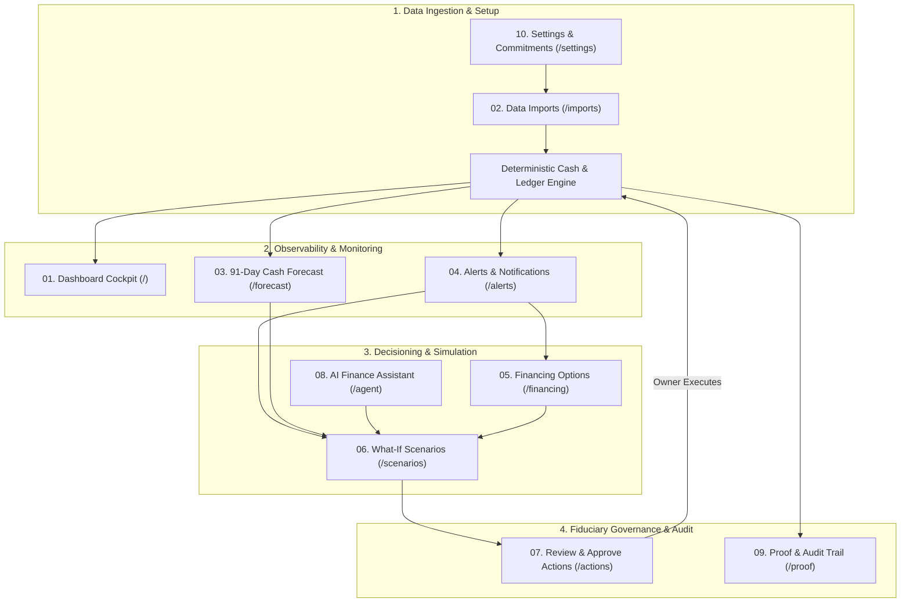

# HarborCFO Platform Documentation: Page Guides Catalog

Welcome to the comprehensive documentation suite for **HarborCFO: Autonomous SME Financial Intelligence**.

This directory contains complete, presentation-ready architectural and component guides for all **10 core pages** of the platform. Each guide is tailored for founders, financial operators, employees, external auditors, and competition judges.

---

## 🗺️ Platform Architecture & Page Map

HarborCFO links daily transaction feeds, deterministic cash projections, risk mitigation, and fiduciary governance into a single continuous workflow:



---

## 📚 Master Catalog of Page Guides

| # | Page / Feature | Route | Primary Audience | Core Value & Focus | Link to Guide |
| :-: | :--- | :--- | :--- | :--- | :--- |
| **01** | **Dashboard** | `/` or `/dashboard` | Owner & Employee | 91-day cockpit, 4 key metrics, 13-week cash curve, plain language mode. | [01-dashboard.md](./01-dashboard.md) |
| **02** | **Data Imports** | `/imports` | Owner & Operators | Zero-fault atomic CSV ingestion, header sniffing, SHA-256 deduplication. | [02-imports.md](./02-imports.md) |
| **03** | **Cash Forecast** | `/forecast` | Owner & Operators | 91-day daily deterministic projection, breach cards, day provenance drawer. | [03-forecast.md](./03-forecast.md) |
| **04** | **Alerts** | `/alerts` | Owner & Employee | 6 deterministic rules (insolvency, floor breach, concentration, repayment). | [04-alerts.md](./04-alerts.md) |
| **05** | **Financing Options** | `/financing` | Owner & Employee | Precision capital matching, 3-pillar facility summaries, APR transparency. | [05-financing.md](./05-financing.md) |
| **06** | **What-If Scenarios** | `/scenarios` | Owner & Operators | Risk-free sandbox, move receipts, defer payables, dual comparison chart. | [06-scenarios.md](./06-scenarios.md) |
| **07** | **Review & Approve Actions** | `/actions` | **Owner (Fiduciary)** | Segregation of duties, time-bound quotes, before/after impact, atomic execution. | [07-actions.md](./07-actions.md) |
| **08** | **AI Finance Assistant** | `/agent` | Owner & Employee | Zero-hallucination conversational AI grounded by clickable Evidence Chips. | [08-agent.md](./08-agent.md) |
| **09** | **Proof & Audit Trail** | `/proof` | Auditors & Underwriters | Real-time invariant tests, double-entry proofs, certified Evidence Bundle ZIP. | [09-proof.md](./09-proof.md) |
| **10** | **Settings & Team** | `/settings` | **Owner-Admin** | Liquidity safety floors, customer concentration caps, recurring commitments, team access. | [10-settings.md](./10-settings.md) |

---

## 🎭 Owner vs. Employee RBAC Summary

HarborCFO enforces a clear operational and fiduciary division of responsibilities across the platform:

```
┌────────────────────────────────────────────────────────┐
│                   COMPANY EMPLOYEES                    │
│ • Diagnosticians & Operators                           │
│ • Upload statements, inspect cash dips, simulate moves │
│ • Prepare term sheet proposals and draft solutions     │
└───────────────────────────┬────────────────────────────┘
                            │ Proposes Action
                            ▼
┌────────────────────────────────────────────────────────┐
│                    COMPANY OWNERS                      │
│ • Fiduciary Approvers & Executive Decision Makers      │
│ • Configure company liquidity floors & policies        │
│ • Legally approve and execute binding debt facilities  │
│ • Manage team access and legal corporate profile       │
└────────────────────────────────────────────────────────┘
```

---

## ⏱️ Pitch Presentation Playbook (5-Minute Demo Flow)

If presenting HarborCFO to judges, investors, or partners, follow this chronological 5-step storyline:

1. **The Problem on the Dashboard (`/`)**:
   - Show healthy current cash ($¥80,000$), but point out the red danger card: cash plummets to $-¥20,000$ on Day 21 ($¥50,000$ gap).
   - Toggle **Plain Language Mode** to show accessibility for non-technical founders.
2. **The Root Cause in Forecast & Alerts (`/forecast` & `/alerts`)**:
   - Drill into Day 21 in the **Forecast** to reveal co-occurring rent and supplier payments.
   - Show the **Customer Concentration Alert**: Apex Distribution Ltd represents $66.7\%$ of unpaid invoices.
3. **Simulating the Fix in Scenarios (`/scenarios`)**:
   - Apply the *"Working Capital Loan"* preset or simulate accelerating Apex Distribution's invoice.
   - Show the orange scenario line lifting safely above the $¥30,000$ safety floor.
4. **Fiduciary Authorization in Actions (`/actions`)**:
   - Show the employee view: *"Pending Owner Approval"* (cannot sign debt).
   - Switch to the Owner view and click **"Approve & Execute"** in the two-step confirmation modal.
   - Show the atomic ledger disbursement instantly resolving the cash gap.
5. **Auditor-Grade Verification in Proof (`/proof`)**:
   - Run **Live Invariant Checks** (debits equal credits, zero negative cash).
   - Download the certified **Evidence Bundle** proving complete mathematical determinism.
